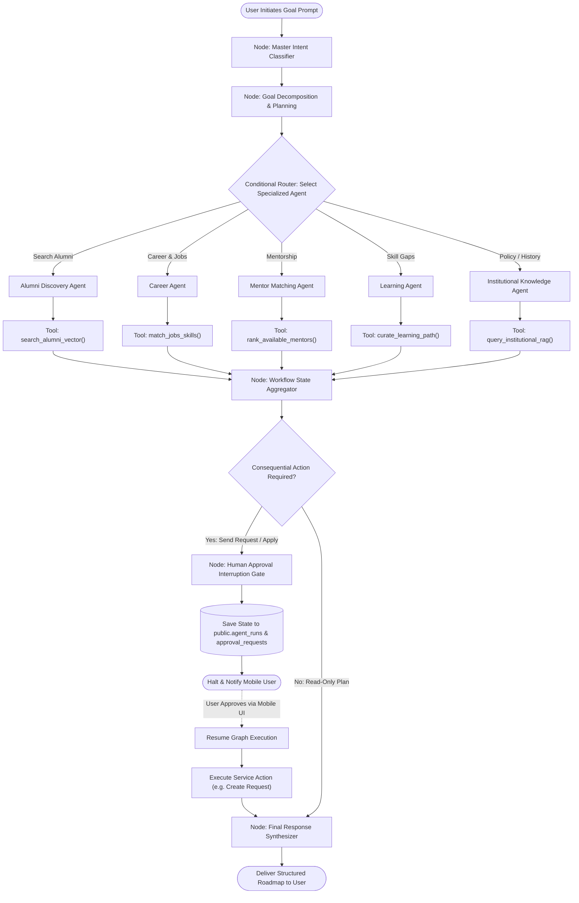

# MSGI One — Agentic AI Architecture (LangGraph Multi-Agent Orchestration)

**Project Title:** MSGI One — Agentic AI-Powered Institutional Alumni Ecosystem  
**Phase:** Phase 0 — Project Foundation and Architecture Lock  
**Author:** AI Systems Architect & Principal Software Architect  
**Date:** November 18, 2026  
**Status:** APPROVED & LOCKED  

---

## 1. Architectural Philosophy & Principles

The MSGI One AI ecosystem is engineered to prevent autonomous agent failure modes (hallucinations, infinite loops, and unauthorized data mutations) by following **Roger S. Pressman** (*Software Engineering*, Ch. 15: "Component-Level Design") and **Martin Kleppmann** (*Designing Data-Intensive Applications*, Ch. 10):
1. **Deterministic StateGraph over Bare ReAct Loops:** All multi-agent workflows are modeled as formal state machines using **LangGraph**. Graph vertices represent specialized agent reasoning or tool executions; edges represent deterministic or conditional transitions.
2. **Deterministic Service Priority:** AI reasoning is reserved solely for semantic retrieval, unstructured goal interpretation, and personalized recommendation. Where deterministic SQL queries or business logic suffice (e.g. checking event capacity or verifying enrollment), ordinary application services are used directly.
3. **Zero Direct Database Access:** Specialized agents possess **no direct SQL execution credentials**. Agents interact exclusively through strictly typed Pydantic tool interfaces bound to Layer C domain services.
4. **Human-in-the-Loop Interruption:** Consequential operations (mentorship requests, job submissions, financial commitments, institutional modifications) pause the execution graph, persist a checkpoint in PostgreSQL, and await human user authorization.



---

## 2. Shared Agent State Contract (`AgentState`)

All nodes in the LangGraph execution graph share a single, strictly typed state dictionary:

```python
from typing import Annotated, Dict, List, Optional, Any
from pydantic import BaseModel, Field
from typing_extensions import TypedDict
import operator

class EntityReference(BaseModel):
    entity_type: str  # 'alumni', 'job', 'mentor', 'course', 'event'
    entity_id: str
    display_title: str
    metadata: Dict[str, Any] = Field(default_factory=dict)

class ActionDraft(BaseModel):
    action_type: str  # 'send_mentor_request', 'apply_job', etc.
    target_id: str
    payload: Dict[str, Any]
    approval_required: bool = True
    approval_id: Optional[str] = None
    status: str = "pending"  # 'pending', 'approved', 'rejected'

class AgentState(TypedDict):
    # Context
    user_id: str
    user_role: str
    session_id: str
    workflow_id: str
    
    # Input
    raw_prompt: str
    interpreted_goal: str
    target_role: Optional[str]
    target_country: Optional[str]
    target_skills: List[str]
    
    # Execution Tracking
    plan_steps: List[str]
    current_step_index: int
    active_agent: str
    execution_trace: Annotated[List[str], operator.add]
    
    # Domain Knowledge Extracted
    matched_alumni: List[Dict[str, Any]]
    recommended_mentors: List[Dict[str, Any]]
    identified_skill_gaps: List[str]
    curated_courses: List[Dict[str, Any]]
    matched_internships: List[Dict[str, Any]]
    
    # Human-in-the-Loop Gate
    consequential_actions: List[ActionDraft]
    workflow_status: str  # 'running', 'awaiting_approval', 'completed', 'failed'
    
    # Final Output
    final_narrative: Optional[str]
    actionable_checklist: List[str]
```

---

## 3. Specialized Domain Sub-Agents

| Agent Name | Primary Responsibility | Authorized Tool Boundaries |
| :--- | :--- | :--- |
| **1. Alumni Discovery Agent** | Natural language and vector similarity alumni directory matching. | `search_alumni_vector`, `get_alumni_details` |
| **2. Global Connect Agent** | Aggregates geographic alumni presence for relocation queries. | `get_regional_chapters`, `find_alumni_by_country` |
| **3. Career Agent** | Matches resumes with job postings; analyzes skill alignment. | `search_verified_jobs`, `compute_skill_match` |
| **4. Mentor Matching Agent**| Matches students to available alumni mentors based on capacity and domain. | `query_available_mentors`, `draft_mentorship_request` |
| **5. Learning Agent** | Identifies skill gaps and retrieves targeted courses. | `analyze_skill_gaps`, `recommend_learning_modules` |
| **6. Event Agent** | Surfaces relevant institutional networking events and webinars. | `query_upcoming_events` |
| **7. Collaboration Agent** | Connects student developers with faculty research projects. | `search_research_projects` |
| **8. Startup Agent** | Evaluates student founder proposals and recommends mentors. | `query_startup_showcase`, `recommend_advisors` |
| **9. Community Agent** | Identifies relevant affinity and discussion groups. | `search_communities` |
| **10. Impact Agent** | Summarizes institutional social impact campaigns and endowments. | `query_giving_campaigns` |
| **11. Institutional Knowledge Agent** | Semantic RAG over institutional policies, regulations, and handbooks. | `query_institutional_rag` |

---

## 4. StateGraph Checkpointing & Persistence

- **Checkpoint Engine:** `PostgresSaver` backed by `public.agent_runs`.
- **Workflow Interruption:** When an agent invokes a consequential tool (e.g., `draft_mentorship_request`), the node executes `langgraph.types.interrupt()`.
- The current graph snapshot, memory state, and serialized variables are written to `public.agent_runs(state_graph_snapshot)`.
- An approval record is created in `public.approval_requests`.
- When the user sends `POST /api/v1/ai/approvals/{id}/decision`, the API loads the checkpoint from `public.agent_runs`, applies the human input, and resumes graph execution until completion.
