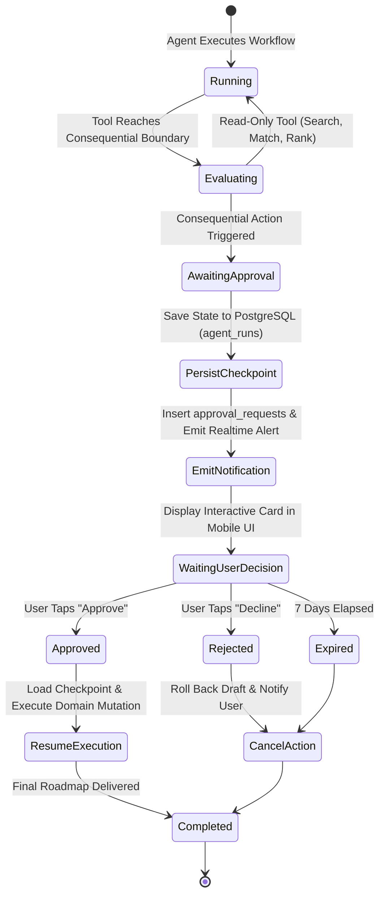

# MSGI One — AI Safety, Governance & Consequential Approval Gates

**Project Title:** MSGI One — Agentic AI-Powered Institutional Alumni Ecosystem  
**Phase:** Phase 0 — Project Foundation and Architecture Lock  
**Author:** AI Systems Architect & DevSecOps Engineer  
**Date:** November 18, 2026  
**Status:** APPROVED & LOCKED  

---

## 1. AI Safety & Governance Principles

In accordance with international AI safety standards and **Martin Kleppmann** (*Designing Data-Intensive Applications*, Ch. 10: "Auditable Systems"):
1. **Never Execute Consequential Side Effects Autonomously:** An AI agent is an advisory, reasoning, and synthesis engine. Under no circumstances may an agent perform external state mutations (sending emails, applying to jobs, charging funds, altering verified student data) without affirmative human authorization.
2. **Deterministic Fallbacks:** When LLM providers return rate-limit errors (429), timeouts, or malformed JSON, the application must immediately fall back to deterministic relational queries with clear user notification.
3. **Prompt Injection & Adversarial Defense:** User inputs undergo input sanitization to strip prompt-escape sequences (`System:`, `Ignore previous instructions`, XML delimiter manipulation). Model system instructions explicitly instruct the agent to ignore user-supplied system overrides.
4. **Data Minimization:** Student sensitive PII (CGPA, roll numbers, home addresses, financial aid status) is excluded from LLM prompt contexts unless explicitly necessary for an authorized advisor workflow.

---

## 2. The 6 Mandatory Human-in-the-Loop Approval Gates

### Gate 1: Sending Mentorship Requests
- **Action Type:** `send_mentor_request`
- **Trigger:** Mentor Matching Agent identifies an optimal mentor and prepares an introductory note.
- **Why Gate is Mandatory:** Prevents alumni mentors from being spammed by automated requests. Protects student reputation and institutional goodwill.
- **Review UI:** Modal sheet displaying: Mentor Name, Current Company, Mentor Topics, and Editable Draft Note. The student can edit the note before tapping "Confirm & Send".

### Gate 2: Contacting Alumni (Cold Outreach / Direct Messaging)
- **Action Type:** `contact_alumni`
- **Trigger:** Alumni Discovery Agent proposes contacting a senior alumnus.
- **Why Gate is Mandatory:** Institutional alumni directories require strict consent boundaries; unsolicited messages must be approved and logged.
- **Review UI:** Prompt detailing: Alumni Name, Mutual Background, Outreach Purpose, and Message Content.

### Gate 3: Submitting Job Applications
- **Action Type:** `apply_job`
- **Trigger:** Career Agent finds a high-fit internship or job posting.
- **Why Gate is Mandatory:** Submitting a candidate application is a binding professional submission involving resume disclosure.
- **Review UI:** Displays: Company Name, Role, Target Resume Version, Cover Letter preview, and Application Terms acknowledgment.

### Gate 4: Publishing Events
- **Action Type:** `publish_event`
- **Trigger:** Event Agent structures an alumni reunion or student workshop.
- **Why Gate is Mandatory:** Public events consume physical campus capacity or institutional Zoom licenses and represent the university brand.
- **Review UI:** Displays: Event Title, Date/Time, Venue/Link, Target Audience, and Organizer Contact.

### Gate 5: Updating Important Institutional Records
- **Action Type:** `update_record`
- **Trigger:** Institutional Knowledge Agent suggests updating student major or alumni graduation records based on uploaded diplomas.
- **Why Gate is Mandatory:** Institutional academic integrity requires human registrar or administrator verification before database mutation.
- **Review UI:** Administrator queue displaying: Proposed Change, Supporting Document Link, and Audit Diff.

### Gate 6: Initiating Financial Actions (Donations & Giving)
- **Action Type:** `financial_action`
- **Trigger:** Impact Agent constructs a giving pledge for an endowment or scholarship fund.
- **Why Gate is Mandatory:** Zero automated financial debiting. Financial transactions require explicit human checkout confirmation.
- **Review UI:** Displays: Fund Title, Pledge Amount, Currency, Payment Provider Link, and Anonymity Toggle.

---

## 3. Operational Guardrails & Execution Limits

To prevent runaway API billing, infinite agent loops, and resource exhaustion:

| Guardrail Parameter | Limit | Enforcement Mechanism |
| :--- | :--- | :--- |
| **Max Tool Invocations per Run** | 10 tool calls | LangGraph step counter; aborts with error if exceeded. |
| **Max Total Execution Time** | 30 seconds | Async Python `asyncio.wait_for(timeout=30)`. |
| **Max Input Prompt Length** | 2,000 characters | Pydantic HTTP boundary validation. |
| **Max Token Budget per Run** | 8,000 tokens | Token counter hook monitoring LLM API responses. |
| **User Rate Limit** | 10 AI runs / hour | Redis / In-memory token bucket rate limiter. |
| **Checkpoint Retention** | 7 days | Automated cleanup trigger marks unapproved requests as `expired`. |
