# MSGI One — Entity-Relationship (ER) Diagram

**Project Title:** MSGI One — Agentic AI-Powered Institutional Alumni Ecosystem  
**Phase:** Phase 0 — Project Foundation and Architecture Lock  
**Author:** Database Architect & Systems Modeler  
**Date:** November 18, 2026  
**Status:** APPROVED & LOCKED  

---

## 1. Complete Relational ER Model (Mermaid)

```mermaid
erDiagram
    users ||--o{ user_roles : "has"
    roles ||--o{ user_roles : "assigned_to"
    users ||--o| alumni_profiles : "extends (if alumni)"
    users ||--o| student_profiles : "extends (if student)"
    users ||--o| faculty_profiles : "extends (if faculty)"
    users ||--o| recruiter_profiles : "extends (if recruiter)"
    users ||--o{ consent_records : "authorizes"
    users ||--o| user_preferences : "configures"
    users ||--o| alumni_locations : "locates"

    users ||--o{ user_skills : "possesses"
    skills ||--o{ user_skills : "categorizes"

    alumni_profiles ||--o{ employment_history : "records"
    alumni_profiles ||--o| mentor_profiles : "offers"
    
    users ||--o{ connections : "requests"
    users ||--o{ connections : "receives"

    users ||--o{ jobs : "posts"
    jobs ||--o{ job_applications : "receives"
    users ||--o{ job_applications : "submits"

    student_profiles ||--o{ career_goals : "defines"
    mentor_profiles ||--o{ mentor_requests : "receives"
    users ||--o{ mentor_requests : "submits"
    mentor_requests ||--o{ mentor_sessions : "schedules"

    users ||--o{ events : "organizes"
    events ||--o{ event_registrations : "contains"
    users ||--o{ event_registrations : "attends"

    users ||--o{ communities : "creates"
    communities ||--o{ community_memberships : "enrolls"
    users ||--o{ community_memberships : "joins"

    courses ||--o{ learning_progress : "tracks"
    users ||--o{ learning_progress : "completes"

    users ||--o{ projects : "leads"
    projects ||--o{ project_members : "includes"
    users ||--o{ project_members : "contributes"

    users ||--o{ startups : "founds"
    startups ||--o{ startup_members : "employs"
    users ||--o{ startup_members : "joins"

    impact_programmes ||--o{ donation_records : "funds"
    users ||--o{ donation_records : "pledges"
    users ||--o{ volunteering_records : "logs"

    users ||--o{ agent_runs : "initiates"
    agent_runs ||--o{ agent_actions : "executes"
    agent_runs ||--o{ approval_requests : "requires"
    users ||--o{ approval_requests : "reviews"

    users ||--o{ notifications : "receives"
    users ||--o{ audit_logs : "triggers"

    users {
        uuid id PK
        varchar email UK
        varchar first_name
        varchar last_name
        boolean is_verified
        boolean is_active
        timestamptz created_at
    }

    roles {
        varchar id PK
        text description
    }

    user_roles {
        uuid id PK
        uuid user_id FK
        varchar role_id FK
        timestamptz assigned_at
    }

    alumni_profiles {
        uuid id PK
        uuid user_id FK
        integer graduation_year
        varchar degree
        varchar major
        varchar current_company
        varchar current_title
        vector embedding
        varchar visibility
    }

    student_profiles {
        uuid id PK
        uuid user_id FK
        varchar roll_number UK
        integer enrollment_year
        integer expected_graduation_year
        varchar department
        numeric cgpa
        text resume_url
    }

    mentor_profiles {
        uuid id PK
        uuid alumni_id FK
        text_array topics
        integer max_mentees
        integer active_mentees
        boolean is_accepting_requests
    }

    mentor_requests {
        uuid id PK
        uuid mentee_id FK
        uuid mentor_id FK
        text goal_statement
        varchar status
        timestamptz created_at
    }

    jobs {
        uuid id PK
        uuid posted_by FK
        varchar company_name
        varchar title
        varchar employment_type
        varchar location
        text_array required_skills
        timestamptz application_deadline
        boolean is_active
        vector embedding
    }

    job_applications {
        uuid id PK
        uuid job_id FK
        uuid applicant_id FK
        text resume_url
        varchar status
        timestamptz applied_at
    }

    events {
        uuid id PK
        uuid organizer_id FK
        varchar title
        varchar category
        varchar location_type
        timestamptz start_time
        timestamptz end_time
        integer capacity
        integer registered_count
    }

    agent_runs {
        uuid id PK
        uuid user_id FK
        varchar workflow_type
        text prompt_input
        varchar status
        jsonb final_output
        timestamptz created_at
    }

    approval_requests {
        uuid id PK
        uuid run_id FK
        uuid user_id FK
        varchar action_type
        jsonb payload
        varchar status
        timestamptz created_at
    }
```

---

## 2. Referential Cardinality Summary

1. `users` to `alumni_profiles` / `student_profiles` / `faculty_profiles` / `recruiter_profiles`: **1 to 0..1** (Sub-type extension based on assigned role).
2. `users` to `user_roles`: **1 to 1..N** (A user must hold at least one role; may hold multiple e.g. `alumni` and `recruiter`).
3. `alumni_profiles` to `mentor_profiles`: **1 to 0..1** (Alumni optionally register as mentors).
4. `jobs` to `job_applications`: **1 to 0..N** (A job listing receives multiple applications; unique composite constraint per `(job_id, applicant_id)`).
5. `mentor_profiles` to `mentor_requests`: **1 to 0..N** (Mentors receive incoming student mentorship requests).
6. `agent_runs` to `approval_requests`: **1 to 0..N** (Agentic workflows pause and spawn approval gates upon hitting consequential tool invocations).
