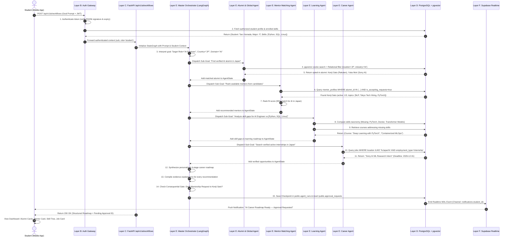

# MSGI One — Primary End-to-End Integration Workflow

**Project Title:** MSGI One — Agentic AI-Powered Institutional Alumni Ecosystem  
**Phase:** Phase 0 — Project Foundation and Architecture Lock  
**Author:** AI Systems Architect & Senior Full-Stack Engineer  
**Date:** November 18, 2026  
**Status:** APPROVED & LOCKED  

---

## 1. Scenario Definition

### User Input Prompt
> *"I am an IT student. I want to become an AI engineer in Japan. Find suitable MSGI alumni, recommend mentors, identify missing skills, suggest learning resources and find internships."*

### System Objective
Execute an integrated, multi-agent reasoning, semantic retrieval, and recommendation cycle spanning 5 modules (Alumni Network, Global Connect, MentorMatch, Learning Academy, and CareerBridge), producing a cohesive, actionable career roadmap with safe human approval gates.

---

## 2. Mermaid Sequence Diagram



---

## 3. Step-by-Step Execution Trace

| Step # | Execution Phase | Responsible Layer / Component | Exact Action Taken | Data Flow & Database Interaction |
| :---: | :--- | :--- | :--- | :--- |
| **1** | Authentication | Layer B (Auth Gateway) | Cryptographically verify Supabase Bearer JWT. | Validates RS256 signature; extracts `sub = "taro-yamada-uuid"`. |
| **2** | Profile Resolution | Layer B (Auth Gateway) | Fetch active student profile and enrolled skills. | `SELECT department, cgpa, skills FROM student_profiles JOIN user_skills ... WHERE user_id = :uid`. Returns: `[Python, SQL, Linux]`. |
| **3** | Intent Decomposition | Layer E (Master Orchestrator) | Decompose prompt into structured parameters. | Extracted entities: `target_role: "AI Engineer"`, `target_country: "JP"`, `target_industry: "Artificial Intelligence"`. |
| **4** | Alumni Semantic Search | Layer E (Alumni Discovery Agent) | Vector similarity search over alumni embeddings. | `SELECT * FROM alumni_profiles WHERE embedding <=> :query_vector < 0.35`. |
| **5** | Visibility Filtering | Layer D (PostgreSQL / RLS) | Filter candidates by consent and location opt-in. | Applies `WHERE visibility IN ('public', 'institutional') AND country_code = 'JP'`. Found: Kenji Sato (Rakuten), Yuka Mori (Sony AI). |
| **6** | Mentor Retrieval | Layer E (Mentor Matching Agent) | Query mentor capacity for matched alumni. | `SELECT * FROM mentor_profiles WHERE alumni_id IN (:matched_ids) AND is_accepting_requests = TRUE AND active_mentees < max_mentees`. |
| **7** | Mentor Ranking | Layer E (Mentor Matching Agent) | Score mentor fit against mentee goals. | Kenji Sato scored 0.95 (Expertise: PyTorch, Relocation to Japan, Bilingual). Active slots: 2 available. |
| **8** | Skill Gap Analysis | Layer E (Learning Agent) | Compare student skills against required job skills. | Current: `[Python, SQL, Linux]`. Required: `[Python, PyTorch, Transformers, Docker]`. Gap identified: `[PyTorch, Transformers, Docker]`. |
| **9** | Learning Pathway Retrieval| Layer E (Learning Agent) | Query institutional courses addressing missing skills. | `SELECT * FROM courses WHERE associated_skills && ARRAY['PyTorch', 'Docker']`. Returns 2 curated tracks. |
| **10**| Internship Opportunity Search| Layer E (Career Agent) | Query verified active job openings in target country. | `SELECT * FROM jobs WHERE location ILIKE '%Tokyo%' AND employment_type = 'internship' AND is_active = TRUE`. |
| **11**| Eligibility Verification | Layer E (Career Agent) | Validate applicant eligibility and deadline freshness. | Confirms application deadline (2026-12-31) is future-dated; matches major (IT) with posting prerequisites. |
| **12**| Roadmap Generation | Layer E (Master Orchestrator) | Synthesize 4-phase structured timeline. | Phase 1 (Weeks 1-4): Skill Mastery; Phase 2 (Weeks 5-8): Mentorship; Phase 3 (Weeks 9-12): Application. |
| **13**| Recommendation Evidence | Layer E (Master Orchestrator) | Attach transparent rationale to all items. | "Kenji Sato recommended because he graduated from IT in 2021 and transitioned to Tokyo as an ML Engineer." |
| **14**| Consequential Action Draft| Layer E (Human-in-the-Loop Gate) | Draft mentorship request to Kenji Sato. | Creates pending draft payload; blocks auto-sending; triggers `approval_required: true`. |
| **15**| Workflow State Persistence| Layer D & Layer F (DB & Realtime)| Write run state and broadcast alert. | Inserts into `agent_runs` and `approval_requests`. Emits WebSocket alert to mobile app. |

---

## 4. Expected Output Delivered to Mobile UI

The API returns a typed JSON payload rendered by the mobile client as a rich interactive dashboard:

```json
{
  "status": "success",
  "data": {
    "workflow_id": "9d1f3b2a-6c4e-4f8a-9e12-3b4c5d6e7f8a",
    "status": "awaiting_approval",
    "summary": {
      "target_role": "AI Engineer",
      "target_country": "Japan",
      "readiness_score": "68%"
    },
    "matched_alumni": [
      {
        "alumni_id": "e2a1b3c4-d5e6-4f7a-8b9c-0d1e2f3a4b5c",
        "name": "Kenji Sato",
        "title": "Staff AI Engineer at Rakuten",
        "location": "Tokyo, Japan",
        "graduation_year": 2021,
        "evidence": "MSGI IT alumnus currently leading NLP production pipelines in Tokyo."
      }
    ],
    "mentor_recommendation": {
      "mentor_profile_id": "8a3d5e21-9b4c-4e8a-bf12-9c8e7a6b5c4d",
      "mentor_name": "Kenji Sato",
      "match_score": 0.95,
      "available_slots": 2,
      "advisory_topics": ["Tokyo Tech Relocation", "PyTorch in Production", "Japanese Corporate Culture"]
    },
    "skill_gap_analysis": {
      "current_skills": ["Python", "SQL", "Linux"],
      "missing_skills": ["PyTorch", "Hugging Face Transformers", "Docker & MLOps"],
      "recommended_courses": [
        {
          "course_id": "c1a2b3c4-d5e6-4f7a-8b9c-0d1e2f3a4b5c",
          "title": "Deep Learning with PyTorch & Hugging Face",
          "provider": "MSGI Academy",
          "estimated_duration": "4 weeks"
        }
      ]
    },
    "internship_opportunities": [
      {
        "job_id": "j9a8b7c6-d5e4-4f3a-2b1c-0d1e2f3a4b5c",
        "title": "Machine Learning Research Intern",
        "company": "Sony AI",
        "location": "Tokyo, Japan (Hybrid)",
        "deadline": "2026-12-31T23:59:59Z"
      }
    ],
    "pending_approval": {
      "approval_id": "a1b2c3d4-e5f6-4a7b-8c9d-0e1f2a3b4c5d",
      "action_type": "send_mentor_request",
      "target": "Kenji Sato",
      "draft_message": "Hello Kenji-san, I am Taro Yamada, a 3rd-year IT student at MSGI aspiring to work as an AI Engineer in Tokyo. I would deeply appreciate your mentorship regarding career transitions to Japan.",
      "prompt": "Would you like to send this mentorship request to Kenji Sato?"
    }
  },
  "timestamp": "2026-11-18T13:40:00.000Z"
}
```

---

## 5. Verification & Acceptance Criteria for Step 8

This workflow serves as the primary integration benchmark for Phase 3 and Phase 5:
- [x] Uses the shared relational schema without duplicating tables.
- [x] Applies privacy consent filtering before displaying alumni data.
- [x] Restricts AI agents to strictly typed Pydantic tools.
- [x] Contains an affirmative human-in-the-loop approval gate.
- [x] Persists state graph checkpoints for asynchronous recovery.
