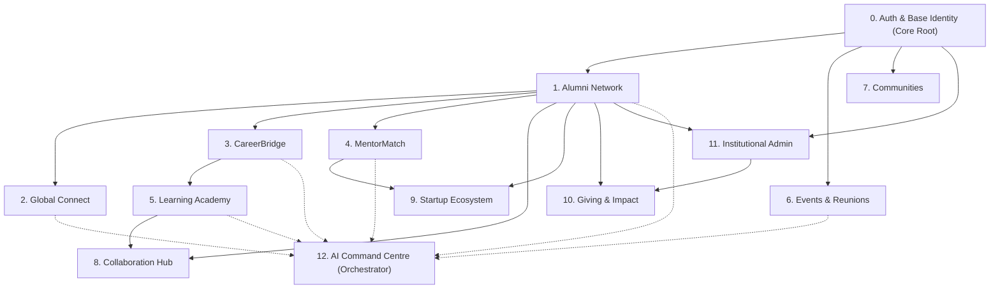

# MSGI One — Module Dependency Matrix & Shared Entity Ownership

**Project Title:** MSGI One — Agentic AI-Powered Institutional Alumni Ecosystem  
**Phase:** Phase 0 — Project Foundation and Architecture Lock  
**Author:** Principal Software Architect & Database Architect  
**Date:** November 18, 2026  
**Status:** APPROVED & LOCKED  

---

## 1. Module Dependency Matrix

This matrix maps upstream dependencies (modules that must be implemented/present first) against downstream consumers. An `X` in row `A` and column `B` signifies that Module `A` depends on Module `B`.

| Module | 0. Auth / Identity | 1. Alumni Net | 2. Global Con | 3. Career | 4. Mentor | 5. Learn | 6. Events | 7. Comm | 8. Collab | 9. Startup | 10. Giving | 11. Admin | 12. AI Cmd | MVP Tier |
| :--- | :---: | :---: | :---: | :---: | :---: | :---: | :---: | :---: | :---: | :---: | :---: | :---: | :---: | :---: |
| **0. Auth / Base Identity** | — | | | | | | | | | | | | | **P0** |
| **1. Alumni Network** | **X** | — | | | | | | | | | | | | **P0** |
| **2. Global Connect** | **X** | **X** | — | | | | | | | | | | | **P1** |
| **3. CareerBridge** | **X** | **X** | | — | | | | | | | | | | **P0** |
| **4. MentorMatch** | **X** | **X** | | | — | | | | | | | | | **P0** |
| **5. Learning Academy** | **X** | | | **X** | | — | | | | | | | | **P1** |
| **6. Events & Reunions** | **X** | | | | | | — | | | | | | | **P0** |
| **7. Communities** | **X** | | | | | | | — | | | | | | **P2** |
| **8. Collab Hub** | **X** | **X** | | | | **X** | | | — | | | | | **P2** |
| **9. Startup Ecosystem** | **X** | **X** | | | **X** | | | | | — | | | | **P2** |
| **10. Giving & Impact** | **X** | **X** | | | | | | | | | — | **X** | | **P1** |
| **11. Admin & Connect** | **X** | **X** | | | | | | | | | | — | | **P1** |
| **12. AI Command Centre**| **X** | **X** | **X** | **X** | **X** | **X** | **X** | | | | | | — | **P0** |

---

## 2. Acyclic Dependency Analysis (DAG Verification)

Following **Ian Sommerville** (*Software Engineering*, Ch. 6) and **Robert C. Martin's Acyclic Dependencies Principle (ADP)**, the module dependency graph must be a strict **Directed Acyclic Graph (DAG)**.

- **Topological Order:**
  `Auth / Identity` -> `Alumni Network` -> `[Global Connect, CareerBridge, MentorMatch, Events, Admin]` -> `[Learning Academy, Giving]` -> `[Collab Hub, Startup Ecosystem]` -> `AI Command Centre`.
- **Circular Dependencies Detected:** **Zero (0).** The dependency graph is provably acyclic. No lower-tier module imports or depends upon a higher-tier module.

---

## 3. Shared Entity Ownership & Boundary Protection

To adhere strictly to **Eric Evans' Domain-Driven Design** principles, each database entity has exactly **one owner aggregate** responsible for writes and schema mutations. Other modules access shared entities in read-only mode via foreign keys or domain service interfaces.

| Database Entity | Owner Bounded Context | Consumer Modules (Read-Only / FK Reference) | Purpose |
| :--- | :--- | :--- | :--- |
| `users` | Identity & Access Domain | All Modules (1 through 12) | Central authentication record, email, status, timestamps. |
| `roles` & `user_roles` | Identity & Access Domain | All Modules (Authorization guards) | Role assignments (`student`, `alumni`, `faculty`, `recruiter`, `admin`). |
| `consent_records` | Identity & Access Domain | Alumni Network, Global Connect, AI Command | Explicit user consent for directory visibility and AI processing. |
| `alumni_profiles` | Alumni Network (Module 1) | Global Connect, MentorMatch, Giving, Startups, AI | Graduation year, degree, headline, bio, verification status. |
| `student_profiles` | Identity & Access Domain | CareerBridge, MentorMatch, Learning, AI | Major, enrollment year, CGPA, target graduation. |
| `skills` & `user_skills` | Shared Competency Registry | Alumni Network, CareerBridge, MentorMatch, Learning, AI | Standardized taxonomy of technical and soft skills. |
| `jobs` & `job_applications`| CareerBridge (Module 3) | Learning Academy, AI Command Centre | Job postings, requirements, student submissions. |
| `mentor_profiles` | MentorMatch (Module 4) | Alumni Network, AI Command Centre | Availability, max mentees, topics, rating. |
| `events` & `event_registrations` | Events & Reunions (Module 6)| Alumni Network, AI Command Centre | Institutional calendar, RSVPs, attendance tracking. |
| `agent_runs` & `approval_requests` | AI Command Centre (Module 12)| All Modules initiating AI actions | Workflow checkpoints, execution traces, human approvals. |

---

## 4. MVP Phasing & Implementation Gates

The dependency matrix directly dictates the implementation sequence for the 3-day MVP:

1. **Day 1 Foundation Gate:** Core Auth, `users`, `roles`, `alumni_profiles`, `student_profiles`, `consent_records`, and basic directory query endpoints.
2. **Day 2 Core Domain Gate:** `CareerBridge` (Jobs), `MentorMatch` (Mentors & Requests), `Events & Reunions`, and `LangGraph AI Orchestrator`.
3. **Day 3 Integration Gate:** `Global Alumni Connect`, `Admin Verification Queue`, Mobile Push/Realtime notifications, and Android APK compilation.
