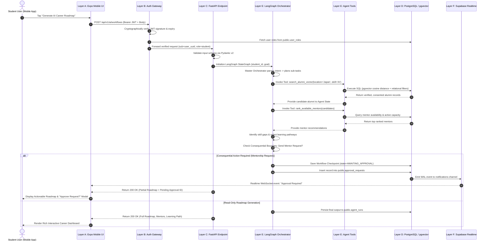

# MSGI One — System Architecture Specification

**Project Title:** MSGI One — Agentic AI-Powered Institutional Alumni Ecosystem  
**Phase:** Phase 0 — Project Foundation and Architecture Lock  
**Author:** Principal Software Architect, Senior Full-Stack Engineer, AI Systems Architect & DevSecOps Engineer  
**Date:** November 18, 2026  
**Status:** APPROVED & LOCKED  

---

## 1. Architectural Overview & Design Principles

MSGI One is structured as an **integrated 7-layer architecture** following the classical separation of concerns documented by **Ian Sommerville** (*Software Engineering*, Chapter 6: "Architectural Design") and **Eric Evans** (*Domain-Driven Design*, Chapter 4: "Isolated Domain").

The system strictly avoids the antipattern of smart clients communicating directly with raw database tables without business mediation. Every business operation and AI reasoning cycle passes through verified API boundaries enforcing role-based access control, cryptographic token verification, and transactional consistency.

```mermaid
flowchart TD
    subgraph Layer_A ["Layer A: Presentation Layer (Mobile Client)"]
        UI_Nav["Role-Aware Navigation (Expo Router v4)"]
        UI_Screens["Screen Components (Alumni, Career, Mentors, Events, Hub)"]
        UI_State["Client State & Cache (React Query / SecureStore)"]
        UI_Realtime["WebSocket Listener (Supabase Realtime Client)"]
    end

    subgraph Layer_B ["Layer B: Authentication & Authorization Gateway"]
        Auth_Supabase["Supabase Auth (PKCE / JWT RS256)"]
        Auth_Middleware["FastAPI Auth Middleware (Signature & Expiry Check)"]
        Auth_RBAC["Server-Side RBAC & Policy Guard (public.user_roles)"]
    end

    subgraph Layer_C ["Layer C: Business API & Domain Services (FastAPI Modular Monolith)"]
        API_Routers["Versioned REST Routers (/api/v1/*)"]
        API_Validation["Pydantic v2 Request/Response Validation"]
        API_Services["Domain Services (AlumniService, JobService, MentorService, EventService)"]
        API_Errors["Standardized RFC 7807 Error Handler"]
    end

    subgraph Layer_D ["Layer D: Data Persistence & Storage"]
        DB_Postgres["PostgreSQL 15+ (Transactional Storage / 3NF)"]
        DB_Vector["pgvector Extension (HNSW 1536-dim Embeddings)"]
        DB_RLS["Row-Level Security (Tenant & Privacy Isolation)"]
        Storage_S3["Supabase Storage (Signed URLs / S3 Buckets)"]
    end

    subgraph Layer_E ["Layer E: Agentic AI Ecosystem (LangGraph Engine)"]
        AI_Master["MSGI Master Orchestrator (Intent Parser & StateGraph)"]
        AI_SubAgents["Specialised Domain Agents (Alumni, Career, Mentor, Learning)"]
        AI_Tools["Authorised Service Tool Registry (Restricted API Services)"]
        AI_Gate["Human-in-the-Loop Approval Interruption Gate"]
    end

    subgraph Layer_F ["Layer F: Realtime & Event Notifications"]
        CDC_WAL["PostgreSQL WAL Replication Engine"]
        RT_Channels["Supabase Realtime Broadcast & Presence"]
        Push_Service["FCM / APNS Mobile Push Notification Worker"]
    end

    subgraph Layer_G ["Layer G: Observability, Audit & Governance"]
        Log_Structured["JSON Structured Telemetry & Tracing"]
        Audit_Trail["Immutable Database Audit Log (public.audit_logs)"]
        AI_Execution_Log["Agent Run & Tool Execution Trace (public.agent_runs)"]
    end

    %% Interactions
    UI_Screens -->|1. HTTPS Request + Bearer JWT| Auth_Middleware
    UI_Nav --> UI_Screens
    Auth_Supabase -.->|Issue Tokens| UI_Screens
    Auth_Middleware -->|2. Validated Claims & Sub| Auth_RBAC
    Auth_RBAC -->|3. Authorized Execution| API_Routers
    API_Routers --> API_Validation
    API_Validation --> API_Services
    
    API_Services -->|4a. Direct Relational ACID Queries| DB_Postgres
    API_Services -->|4b. Signed URL Requests| Storage_S3
    API_Services -->|4c. Invoke Agentic Workflow| AI_Master
    
    AI_Master --> AI_SubAgents
    AI_SubAgents -->|Call Bound Tools Only| AI_Tools
    AI_Tools -->|Execute via Domain Service| API_Services
    AI_SubAgents -.->|Consequential Action Trigger| AI_Gate
    AI_Gate -->|Write Pending Approval| DB_Postgres
    
    DB_Postgres -->|5. Commit Log (WAL)| CDC_WAL
    CDC_WAL --> RT_Channels
    RT_Channels -->|6. Realtime WebSocket Push| UI_Realtime
    
    API_Services -.->|Emit Events| Log_Structured
    API_Services -.->|Audit Critical Actions| Audit_Trail
    AI_Master -.->|Trace Steps| AI_Execution_Log
```

---

## 2. Layer-by-Layer Architectural Specification

### 2.1 Layer A — Presentation Layer (Mobile Client)
- **Technology:** React Native (0.76+), Expo SDK (52+), Expo Router v4, TypeScript 5.x.
- **Responsibilities:**
  - Role-specific UI layouts: The root layout reads user roles from the authenticated session and renders the appropriate navigation tree:
    - **Student View:** Focus on MentorMatch, CareerBridge, Learning Academy, Alumni Discovery.
    - **Alumni View:** Focus on Giving, Mentorship Requests, Startup Hub, Reunions, Networking.
    - **Faculty View:** Focus on Academic Collaboration, Student Progress, Institutional Connect.
    - **Recruiter View:** Focus on Job Postings, Candidate Pipeline, Applicant Review.
    - **Admin View:** Focus on User Verification, Analytics, Content Moderation, Audit Logs.
  - Complete UI state lifecycle: Explicit handling of `Idle`, `Loading` (skeleton placeholders), `Empty` states, and `Error` states (with actionable retry buttons).
  - Secure credential storage: Hardware-backed storage of access tokens and refresh tokens via `expo-secure-store`.
  - Offline-first cache: Query caching and optimistic UI updates managed via TanStack Query (React Query).

### 2.2 Layer B — Authentication & Authorisation Gateway
- **Technology:** Supabase Auth + FastAPI Custom Token Verification Middleware.
- **Responsibilities:**
  - Token Issuance: Supabase Auth handles initial authentication (Email/Password, Magic Link, or Google SSO) using the PKCE flow and issues RS256-signed JWTs.
  - Server-Side Cryptographic Verification: FastAPI interceptor verifies token signature against the Supabase JWKS (JSON Web Key Set), validates expiration (`exp`), and extracts the subject claim (`sub`, corresponding to `users.id`).
  - Zero-Trust Identity Enforcement: **Request bodies and headers submitting `user_id` or `role` are strictly ignored.** The authenticated `user_id` is derived solely from the cryptographically verified JWT `sub`.
  - Server-Side Role Resolution: FastAPI checks `public.user_roles` to verify that the active user possesses the required role for the requested endpoint using the dependency `Security(require_role(["alumni", "admin"]))`.

### 2.3 Layer C — Business API & Domain Services
- **Technology:** FastAPI 0.115+, Python 3.12, Pydantic v2.
- **Responsibilities:**
  - Router Segmentation: Domain-separated routers prefixed with `/api/v1/` (`/api/v1/alumni`, `/api/v1/jobs`, `/api/v1/mentors`, etc.).
  - Request/Response Validation: Every endpoint declares strict Pydantic schemas. Invalid payloads are rejected at the HTTP boundary with 422 Unprocessable Entity responses formatted according to RFC 7807.
  - Domain Services: Pure Python service classes encapsulating business logic, transactional boundaries, and domain rules (e.g., `CareerService.apply_to_job(student_id, job_id)`).
  - Global Error Handling: Unified mapping of domain exceptions (e.g., `EntityNotFoundError`, `PermissionDeniedError`, `WorkflowInterruptedError`) to standard HTTP status codes.

### 2.4 Layer D — Data Persistence & Storage
- **Technology:** PostgreSQL 15+ (Supabase), pgvector extension, Supabase Storage.
- **Responsibilities:**
  - Relational Integrity: Enforces foreign key constraints with explicit `ON DELETE` actions (e.g., cascading child profiles upon account deletion, preventing deletion of jobs with active applications).
  - Semantic Vector Store: Houses `embedding vector(1536)` columns on user profiles, job listings, and institutional resources. Utilizes HNSW (Hierarchical Navigable Small World) indexes for sub-50ms cosine distance nearest-neighbor queries.
  - Row-Level Security (RLS): Acts as a second line of defense. Even if an internal query runs, PostgreSQL RLS policies prevent users from reading private un-consented profile data or updating records they do not own.
  - Object Storage: S3-compatible storage buckets with signed URL generation. Resumes and transcripts are placed in private buckets accessible only via time-limited signed URLs generated by the API.

### 2.5 Layer E — Agentic AI Ecosystem (LangGraph Engine)
- **Technology:** LangGraph, LangChain Core, Google Gemini 1.5/2.0 Flash / OpenAI API.
- **Responsibilities:**
  - Intent Interpretation: Master Orchestrator parses natural language prompts from users and routes tasks across specialized sub-agents.
  - Tool Security: **Agents have NO direct database access.** Agents execute actions exclusively through registered, typed Pydantic tools that call Layer C domain services.
  - StateGraph Persistence: LangGraph checkpoints workflow state in PostgreSQL (`public.agent_runs`). Long-running workflows survive process restarts.
  - Human-in-the-Loop Interruption: Consequential tools trigger a workflow pause, transition the state to `AWAITING_APPROVAL`, and create an approval record in `public.approval_requests`. The user is notified on mobile to approve or reject the action.

### 2.6 Layer F — Realtime & Event Notifications
- **Technology:** Supabase Realtime (PostgreSQL WAL Replication via WebSockets).
- **Responsibilities:**
  - Change Data Capture: Database inserts into `public.notifications` or `public.approval_requests` automatically emit WebSocket messages to subscribed mobile clients.
  - Mobile Push Integration: Background worker listens to event triggers to dispatch push notifications (FCM for Android) when the mobile app is backgrounded.

### 2.7 Layer G — Observability, Audit & Governance
- **Technology:** Python `structlog`, PostgreSQL Audit Tables.
- **Responsibilities:**
  - Structured Telemetry: Every HTTP request and background task emits JSON logs with correlation IDs (`request_id`, `user_id`, `trace_id`).
  - Immutable Audit Log: All administrative updates, permission grants, application submissions, and financial donations write append-only records to `public.audit_logs`.
  - AI Execution Records: Every agent invocation logs its input, tool calls, reasoning steps, token usage, latency, and outcome to `public.agent_runs`.

---

## 3. End-to-End Request Lifecycle & Data Flow

To illustrate the integration across all 7 layers, the following sequence demonstrates what occurs when a user initiates an action (e.g., submitting a mentor request or issuing an AI career goal query):



---

## 4. Failure Modes & Fault Tolerance (Kleppmann Resilience Principles)

1. **Transient Network Partitions (Mobile <-> API):**
   - Mobile client employs exponential backoff retry on idempotent requests (`GET`, `PUT`, `DELETE`).
   - Mutations (`POST /api/v1/mentor-requests`) attach a client-generated UUID `Idempotency-Key` header to prevent duplicate execution upon network retry.
2. **AI Provider Outage or Rate Limit:**
   - If the primary LLM provider (e.g. Gemini) returns a 429 or 503, the AI client automatically falls back to secondary endpoints or fails gracefully, returning deterministic relational query results with a message: *"AI reasoning is currently degraded; showing verified directory matches."*
3. **Database Connection Pool Exhaustion:**
   - SQLAlchemy connection pool is configured with strict overflow limits (`pool_size=20`, `max_overflow=10`, `pool_timeout=30s`). Endpoints release database sessions immediately upon query completion using async context managers.

---

## 5. Architectural Sign-Off

The 7-layer architecture satisfies all system requirements. It provides complete role isolation, zero-trust cryptographic authentication, ACID relational integrity, and safe agentic AI execution.
