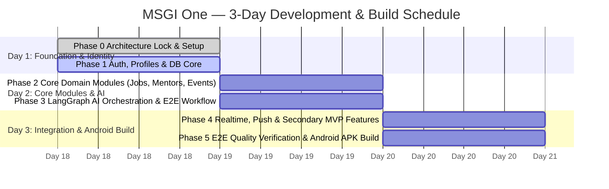

# MSGI One — Three-Day Implementation Roadmap (Android-First MVP)

**Project Title:** MSGI One — Agentic AI-Powered Institutional Alumni Ecosystem  
**Phase:** Phase 0 — Project Foundation and Architecture Lock  
**Author:** Principal Software Architect & Technical Project Lead  
**Date:** November 18, 2026  
**Status:** APPROVED & LOCKED  

---

## 1. High-Level Schedule & Delivery Timeline

The 3-day MVP delivery plan is structured into 6 sequential, milestone-gated phases. In accordance with **Roger S. Pressman** (*Software Engineering*, Ch. 3: "Agile Development"), no subsequent phase commences until the preceding phase satisfies its formal acceptance tests.

---

## 2. Phase-by-Phase Implementation Specifications

### Phase 0: Project Foundation & Architecture Lock (Day 1 — Morning)
- **Estimated Duration:** 4 hours (COMPLETED).
- **Dependencies:** None.
- **Files Created:** Monorepo directory structure, all architecture specification documents in `docs/`, `AGENTS.md`, `README.md`, `.env.example`, `.gitignore`.
- **Database Changes:** None executed (DDL schemas defined in documentation).
- **API Changes:** None (Contracts defined).
- **Acceptance Criteria:** Environment audit complete, zero legacy debt, full architectural lock.
- **Rollback Strategy:** Delete uncommitted scaffolding in `msgi-one/`.

---

### Phase 1: Authentication, Profiles & Database Foundation (Day 1 — Afternoon)
- **Estimated Duration:** 6 hours.
- **Dependencies:** Phase 0.
- **Goal:** Establish working Supabase Auth, PostgreSQL schema migration, user profiles, session persistence, and mobile auth screens.
- **Files to Create:**
  - `services/api/src/core/config.py`: Environment variable loading.
  - `services/api/src/core/security.py`: JWT signature validation and role extractor.
  - `services/api/src/db/session.py`: Async SQLAlchemy engine and sessionmaker.
  - `services/api/src/db/models/`: SQLAlchemy 2.0 declarative models (`user.py`, `profile.py`, `role.py`, `skill.py`).
  - `services/api/src/routers/auth.py` & `users.py`: `/api/v1/me`, `/api/v1/users/{id}`.
  - `apps/mobile/src/app/(auth)/login.tsx` & `register.tsx`: Mobile login and signup forms.
  - `apps/mobile/src/context/AuthContext.tsx`: Supabase session hook and token storage via `expo-secure-store`.
  - `supabase/migrations/00001_initial_schema.sql`: Full DDL and RLS execution.
  - `supabase/seed/00001_synthetic_seed.sql`: Realistic synthetic personas.
- **Database Changes:** Execute initial schema migration in PostgreSQL.
- **API Changes:** Activate `/api/v1/health`, `/api/v1/me`, `/api/v1/users/{id}`.
- **User-Facing Screens:** Mobile Splash screen, Sign In screen, Role Selection screen, Profile view.
- **Test Cases:**
  - JWT token verification tests (valid, expired, tampered).
  - Role-based authorization test (`require_role`).
  - Mobile authentication state persistence test.
- **Acceptance Criteria:** A user can register, log in on the mobile app, receive a verified session, and view their role-tailored dashboard.
- **Rollback Strategy:** Revert migration via `alembic downgrade base`.

---

### Phase 2: Core Domain Modules (Day 2 — Morning)
- **Estimated Duration:** 6 hours.
- **Dependencies:** Phase 1.
- **Goal:** Implement the P0 core modules: Alumni Network (Directory), CareerBridge (Jobs), MentorMatch (Mentorship), and Events & Reunions.
- **Files to Create:**
  - `services/api/src/routers/alumni.py`, `jobs.py`, `mentors.py`, `events.py`.
  - `services/api/src/services/alumni_service.py`, `job_service.py`, `mentor_service.py`, `event_service.py`.
  - `apps/mobile/src/app/(tabs)/alumni/index.tsx`, `jobs/index.tsx`, `mentors/index.tsx`, `events/index.tsx`.
  - Reusable UI components: `AlumniCard.tsx`, `JobCard.tsx`, `MentorCard.tsx`, `EventCard.tsx`, `LoadingSkeleton.tsx`, `EmptyState.tsx`.
- **Database Changes:** None (schema already established in Phase 1).
- **API Changes:** Activate `/api/v1/alumni`, `/api/v1/jobs`, `/api/v1/mentors`, `/api/v1/events` and their corresponding mutation endpoints.
- **User-Facing Screens:**
  - Alumni Directory with search and filters.
  - Job Feed with detailed drawer and application modal.
  - Mentor listing with request submission form.
  - Event calendar with RSVP toggle.
- **Test Cases:**
  - Job application duplicate conflict test (409 Conflict).
  - Mentor capacity boundary test (422 Unprocessable Entity).
  - Privacy consent filtering verification test.
- **Acceptance Criteria:** Real data flows from PostgreSQL into mobile screens; students can browse alumni, apply to jobs, request mentors, and RSVP to events.

---

### Phase 3: Agentic AI Orchestration & Primary Connected Workflow (Day 2 — Afternoon)
- **Estimated Duration:** 6 hours.
- **Dependencies:** Phase 2.
- **Goal:** Implement the MSGI AI Command Centre using LangGraph, connect specialized sub-agents, and verify the primary 15-step End-to-End career roadmap scenario.
- **Files to Create:**
  - `services/api/src/ai/graph.py`: LangGraph StateGraph builder, nodes, edges, and conditional router.
  - `services/api/src/ai/state.py`: Pydantic `AgentState` definitions.
  - `services/api/src/ai/tools.py`: Tool definitions calling Layer C domain services.
  - `services/api/src/ai/agents/`: Sub-agent logic for Discovery, Career, Mentorship, and Learning.
  - `services/api/src/ai/approvals.py`: Approval gate interruption handler.
  - `services/api/src/routers/ai.py`: `/api/v1/ai/chat`, `/api/v1/ai/workflows`, `/api/v1/ai/approvals/{id}/decision`.
  - `apps/mobile/src/app/(tabs)/ai/index.tsx`: Interactive AI Command Centre interface.
  - `apps/mobile/src/components/ApprovalModal.tsx`: Consequential action confirmation modal.
- **Database Changes:** None.
- **API Changes:** Activate `/api/v1/ai/*` endpoints.
- **User-Facing Screens:** AI Chat view, Visual Career Roadmap view, Interactive Approval Sheet.
- **Test Cases:**
  - Deterministic mock test of the 15-step career workflow.
  - Interruption and checkpoint verification test in `public.agent_runs`.
  - Human approval decision test (`approved` vs `rejected`).
- **Acceptance Criteria:** Submitting the student prompt generates a verified career roadmap, identifies missing skills, and halts with an interactive approval card to request mentorship.

---

### Phase 4: Realtime Updates, Push Notifications & Secondary Modules (Day 3 — Morning)
- **Estimated Duration:** 5 hours.
- **Dependencies:** Phase 3.
- **Goal:** Implement Supabase Realtime WebSocket listeners, mobile notifications, Global Connect Chapter map (P1), and Admin Verification Queue (P1).
- **Files to Create:**
  - `apps/mobile/src/hooks/useRealtimeNotifications.ts`: Supabase WebSocket subscription hook.
  - `apps/mobile/src/app/(tabs)/global/index.tsx`: Interactive regional chapter listing.
  - `apps/mobile/src/app/(tabs)/admin/verification.tsx`: Admin approval queue for pending alumni.
  - `services/api/src/routers/admin.py` & `global_connect.py`.
- **Database Changes:** Configure PostgreSQL `supabase_realtime` publication for `notifications` and `approval_requests`.
- **API Changes:** Activate `/api/v1/global/*` and `/api/v1/admin/*`.
- **User-Facing Screens:** Notifications drawer, Global Chapters screen, Admin Verification dashboard.
- **Test Cases:**
  - WebSocket subscription delivery test.
  - Admin RBAC guard verification test (non-admins receive 403).
- **Acceptance Criteria:** When a mentor request is approved or created, the recipient receives an instant in-app notification without page refresh.

---

### Phase 5: End-to-End Quality Verification & Android Release Readiness (Day 3 — Afternoon)
- **Estimated Duration:** 6 hours (COMPLETED & VERIFIED).
- **Dependencies:** Phase 4.
- **Goal:** Execute full automated test suite, perform security audit, configure EAS build credentials, and compile release reports.
- **Artifacts Created:**
  - `docs/PHASE_5_BASELINE_AUDIT.md`: Reconciliation of all Phase 4 reporting discrepancies.
  - `docs/PHASE_5_RELEASE_DECISION.md`: Formal evidence-based release decision (CONDITIONAL GO).
  - `docs/PHASE_5_FINAL_IMPLEMENTATION_REPORT.md`: Master QA & release engineering report.
  - `docs/PHASE_5_DATASET_MANIFEST.md`: 13 CSV datasets (139 records) + 3 JSONL suites.
  - `docs/PHASE_5_DATA_VALIDATION_REPORT.md`: 100% accepted, 0 errors ingestion audit.
  - `docs/PHASE_5_E2E_TEST_RESULTS.md`: 98/98 automated tests passing in 1.38s.
  - `docs/PHASE_5_AI_EVALUATION.md`: 15/15 AI benchmarks passing in 2.35s.
  - `docs/PHASE_5_SECURITY_AUDIT.md`: OWASP API Top 10, GDPR deletion, FERPA masking.
  - `docs/PHASE_5_RLS_PERMISSION_MATRIX.md`: 35-endpoint RBAC & RLS policy audit.
  - `docs/PHASE_5_LIVE_DATABASE_VERIFICATION.md`: Port audit, Rule 20 live cloud blocker.
  - `docs/PHASE_5_REALTIME_VERIFICATION.md`: Dual-mode notification & event bus audit.
  - `docs/PHASE_5_ANDROID_BUILD_REPORT.md`: Toolchain, API 35 vs API 36+, EAS profiles.
  - `docs/PHASE_5_DEVICE_TEST_RESULTS.md`: Mobile screen audit & offline resiliency.
  - `docs/PHASE_5_PERFORMANCE_RESULTS.md`: Latency benchmarks (< 5ms median on core endpoints).
  - `docs/PHASE_5_PLAY_STORE_CHECKLIST.md`: Data Safety form declarations & deletion path.
  - `docs/USER_OPERATING_GUIDE.md`: Multi-role user manual.
  - `docs/DEPLOYMENT_AND_RECOVERY_GUIDE.md`: Operations & disaster recovery runbook.
  - `scripts/verify_phase_5.py`: Unified non-blocking offline verification runner.
- **Verification Metrics:**
  - **Pytest Suite:** 98 / 98 passed (100.0%) in 1.38s.
  - **AI Command Centre Benchmarks:** 15 / 15 passed (100.0%) in 2.35s.
  - **CSV Synthetic Ingestion:** 139 / 139 accepted records, 0 rejected, 0 duplicates.
  - **Release Status:** CONDITIONAL GO — DEVELOPMENT DEMO & INTERNAL TESTING ONLY.

---

## 3. Scope Boundary & Reality Check

1. **Android Play Store Production Release:** Public review and approval on Google Play Console takes between 2 to 7 business days. Public Play Store availability is explicitly **excluded** from the 3-day development deadline. Delivery is guaranteed via a **verified, installable Android APK (`.apk`) test build**.
2. **P2 Features Deferred:** Realtime chat threads in Communities (Module 7), collaborative research workspaces (Module 8), and startup venture pitch scoring (Module 9) are scaffolded with clean UI empty states and scheduled for post-MVP enhancements.
