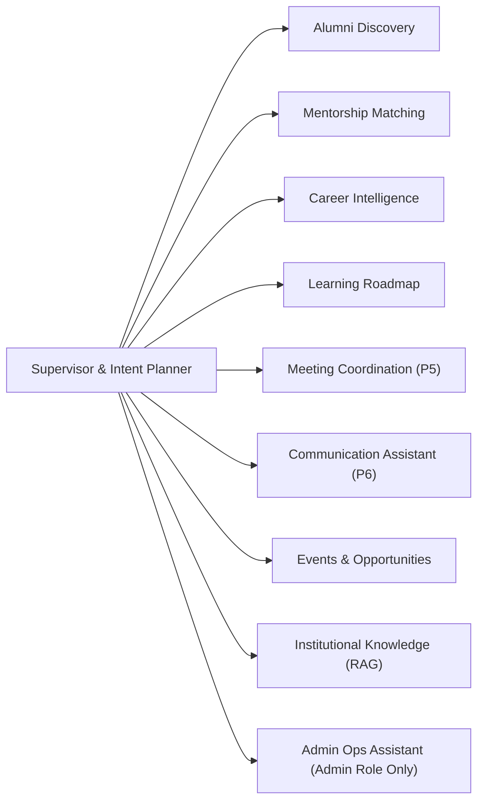

# MSGI ONE — AGENTIC AI ARCHITECTURE V2.0

**Document ID:** MSGI-AI-V2-001  
**Phase:** Phase 1 — Requirements Engineering & Unified System Architecture  
**Governing Textbooks:** Chip Huyen (*Designing Machine Learning Systems*, *AI Engineering*); Stuart Russell & Peter Norvig (*Artificial Intelligence: A Modern Approach*, 4th Ed.); Martin Kleppmann; Robert C. Martin.

---

## 1. Design Philosophy: Rational, Bounded, Authorized Agents

MSGI One's AI layer is not an unconstrained chatbot. In alignment with Russell & Norvig's rational agent model and Chip Huyen's production AI engineering principles, every AI execution is:
1. **Goal-Directed & Bounded:** Finite LangGraph `StateGraph` with explicit maximum iterations (`DEFAULT_MAX_GRAPH_ITERATIONS = 8`), maximum tool calls (`DEFAULT_MAX_TOOL_CALLS = 6`), timeouts, and cancellation.
2. **Identity-Inheriting:** Every graph run and tool invocation inherits the authenticated `AuthenticatedUser` context (`sub`, verified `roles`, `is_verified`). Agents can never elevate privileges or bypass domain authorization.
3. **Unified with Domain Services:** AI tools wrap the exact same domain services used by mobile REST endpoints (e.g., `AlumniService`, `MentorService`, `SchedulingService`, `MessagingService`, `JobsService`, `EventsService`).
4. **Human-in-the-Loop (Rule 15):** Any consequential mutation (mentorship request, meeting request/confirm/reschedule/cancel, sending a message, job application, event registration, admin mutation) interrupts execution, creates a hashed, expiring `ApprovalRequest`, and executes only after explicit authenticated user approval.

---

## 2. Logical Agent Capabilities & Routing

To avoid unnecessary LLM latency and cost, deterministic intent routing and tool calls are combined with provider-backed synthesis/reasoning rather than firing independent LLM calls for trivial routing steps.

---

## 3. Multi-Provider Abstraction & Encrypted Credential Vault

- **Supported Providers:** Google Gemini (`google-genai`), OpenAI, Anthropic Claude, DeepSeek.
- **Vault Security (`ai_provider_configs`):** AES-256-GCM authenticated encryption using a server-side master encryption key (`AI_VAULT_MASTER_KEY` in environment/KMS, never stored in the database or client), per-record unique 96-bit nonce, and Associated Authenticated Data (`provider:config_id:key_version`).
- **Failover & Governance:** Capability metadata (`supports_streaming`, `supports_tools`, `supports_structured_output`, `supports_embeddings`), circuit breakers, exponential backoff on 429/503, and explicit institutional data-governance checks before routing to fallback providers.
- **Embedding Space Isolation:** Preserve 1536-dimensional L2-normalized pgvector (`gemini-embedding-001` space). Incompatible embedding models must never query the same vector column without a versioned re-indexing migration.

---

## 4. Real Token Streaming (`/api/v1/ai/chat/stream`)

Streams SSE frames distinguishing graph lifecycle (`run.started`, `agent.status`, `tool.started`, `tool.completed`, `approval.required`) from generated tokens (`response.delta`), verified entity citations (`citation`), token/cost ledger (`usage`), and terminal completion (`response.completed` / `run.error`). Internal chain-of-thought and private system prompts are never emitted.
