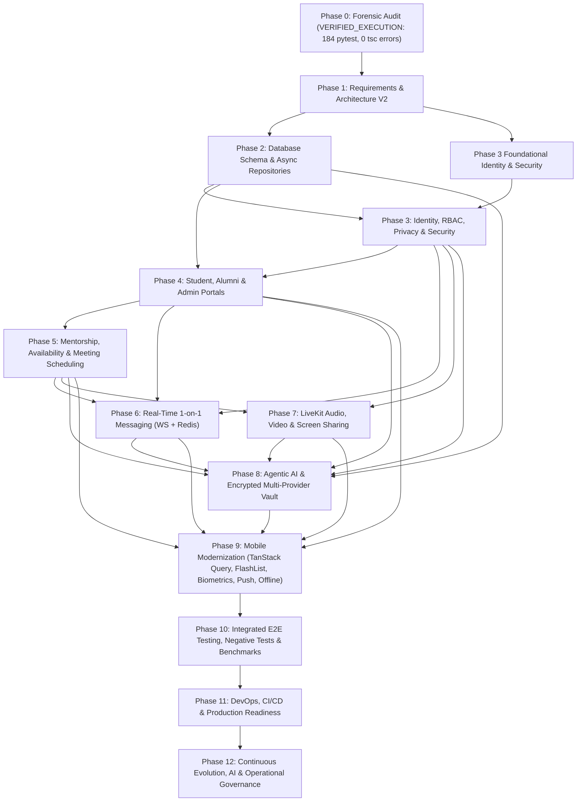

# MSGI ONE — PHASE DEPENDENCY GRAPH & EXECUTION PLAN

**Document ID:** MSGI-PDG-001  
**Date:** November 24, 2026  

## Checkpoint Grouping
- **Checkpoint A:** Phases 1–4 (Architecture, DB Foundation, Identity/Security, Student/Alumni/Admin Portals)
- **Checkpoint B:** Phases 5–7 (Scheduling Engine, WebSocket Messaging, LiveKit Audio/Video)
- **Checkpoint C:** Phases 8–12 (Agentic AI + Encrypted Vault + Streaming, Mobile Modernization, E2E QA & Benchmarks, DevOps, Governance)
