# MSGI ONE — UNIFIED SYSTEM ARCHITECTURE V2.0

**Document ID:** MSGI-ARCH-V2-001  
**Phase:** Phase 1 — Requirements Engineering & Unified System Architecture  
**Date:** November 24, 2026  
**Governing Textbooks:**
- Ian Sommerville, *Software Engineering*, 10th Ed. (Architectural views, layered & repository patterns, dependability).
- Roger S. Pressman & Bruce R. Maxim, *Software Engineering: A Practitioner's Approach*, 9th Ed. (Architectural design, component cohesion).
- Robert C. Martin, *Clean Architecture* (Dependency Rule, SOLID, boundary interfaces).
- Martin Kleppmann, *Designing Data-Intensive Applications* (Replication, transactions, outbox, Pub/Sub vs durable logs).

---

## 1. Architectural Style: Modular Monolith (7-Layer Clean Architecture)

MSGI One retains the **FastAPI Modular Monolith** backed by **PostgreSQL 17 (Supabase) + pgvector**, **Redis** (ephemeral Pub/Sub, presence, rate-limit counters), **LiveKit SFU** (WebRTC media forwarding), and **LangGraph** (bounded agentic AI orchestration).

All entrypoints — Mobile REST, WebSockets (`/ws/chat`), LiveKit room authorization, SSE AI streaming (`/api/v1/ai/chat/stream`), and AI Agent Tools — converge on the same authorized **Application Use-Case & Domain Service Layer** so business rules and authorization checks are never duplicated or bypassed.

---

## 2. C4 & Architectural Diagrams

### 2.1 System Context Diagram
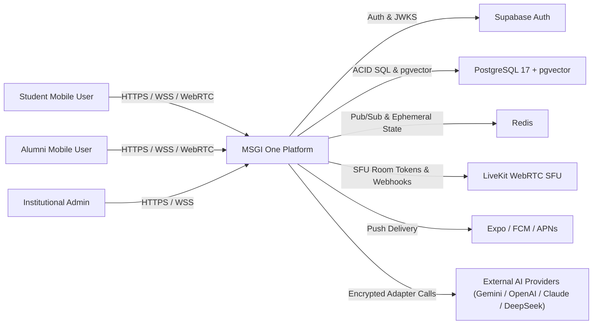

### 2.2 Container Architecture Diagram
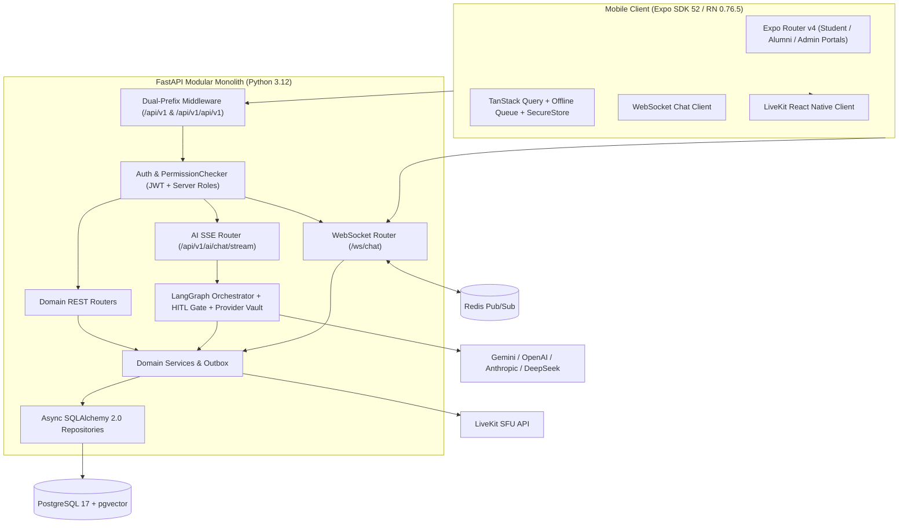

### 2.3 Component Architecture (Clean Architecture Dependency Rule)
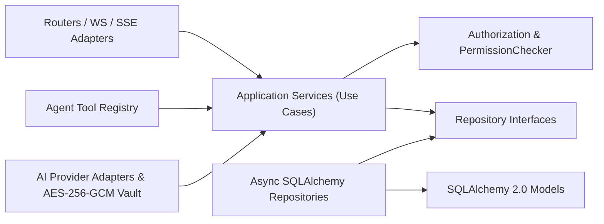

### 2.4 Deployment Architecture
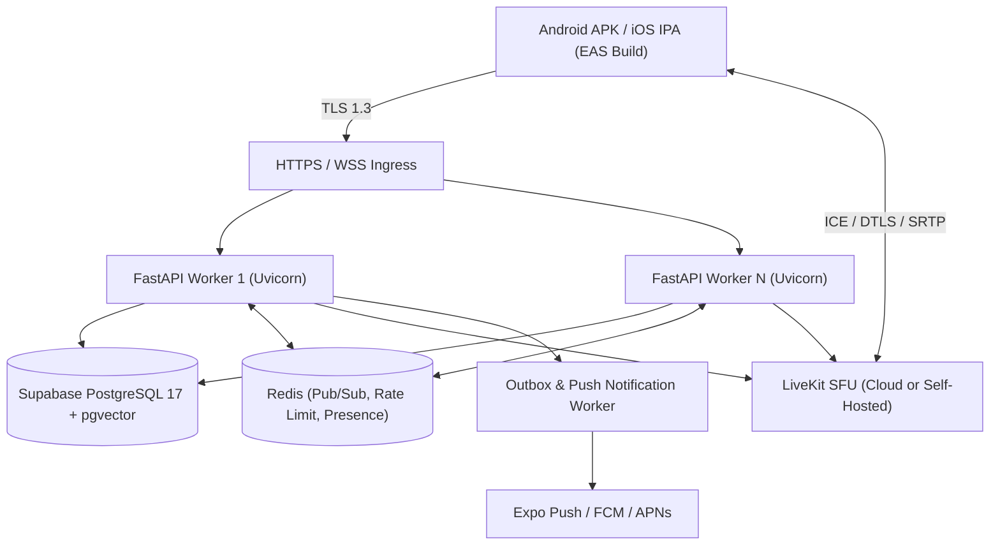

### 2.5 Extended Entity-Relationship (ER) Overview
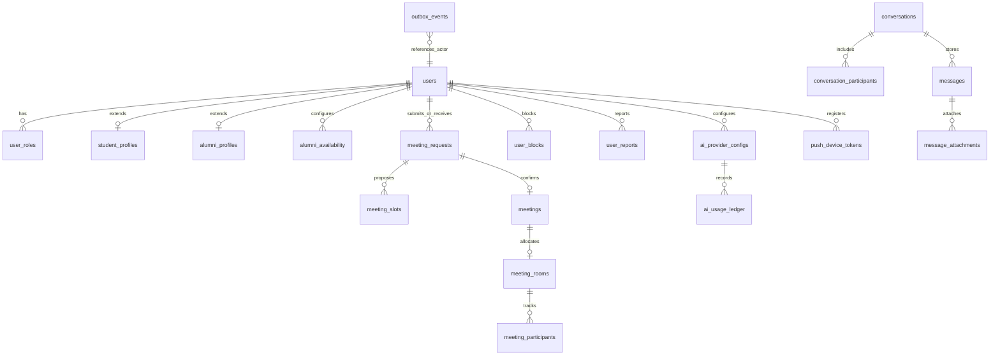

### 2.6 Data-Flow & Trust-Boundary Diagram
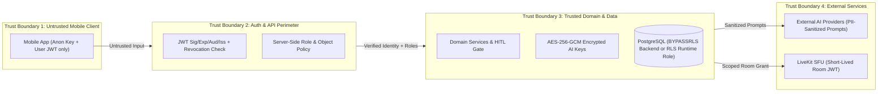

### 2.7 Agent Orchestration Diagram
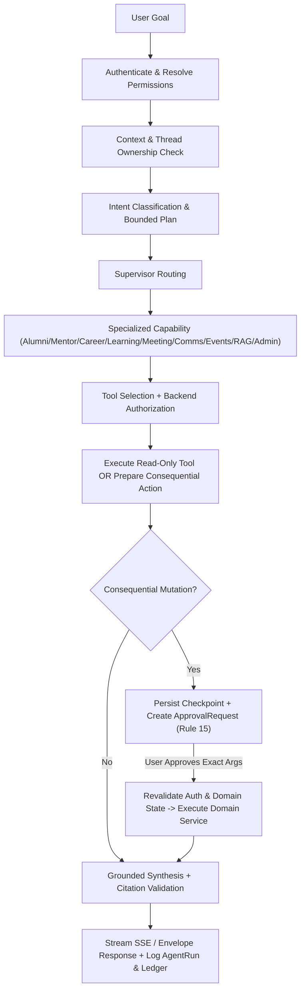

---

## 3. Sequence Diagrams (12 Mandatory Lifecycles)

### 3.1 Student Login & Alumni Login
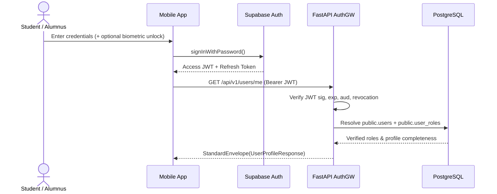

### 3.2 Alumni Verification
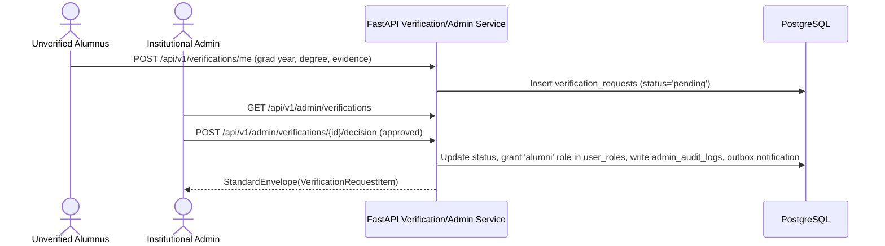

### 3.3 Mentorship Requests
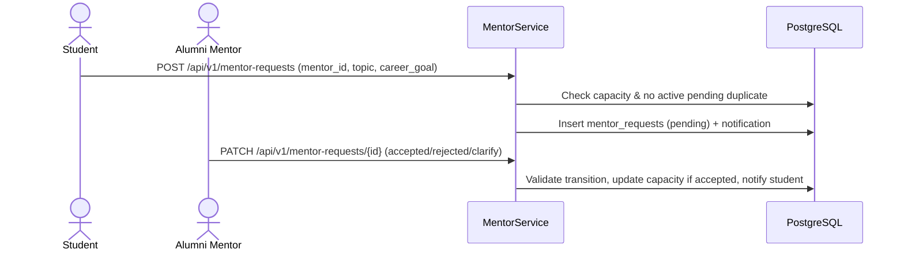

### 3.4 Meeting Requests, Acceptance & Counter-Proposals
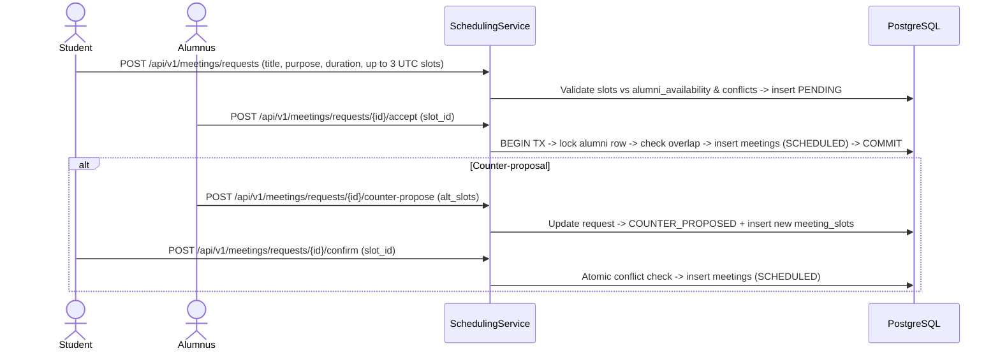

### 3.5 Chat Delivery
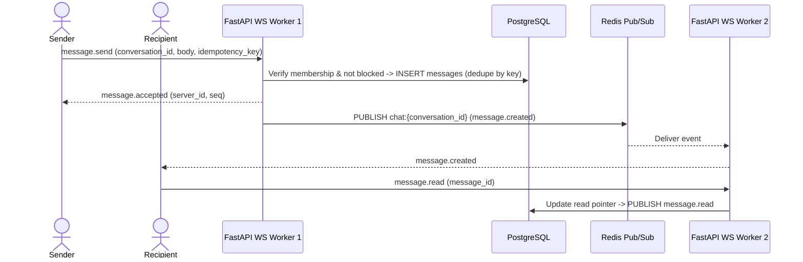

### 3.6 Video Meeting Admission & Screen Sharing
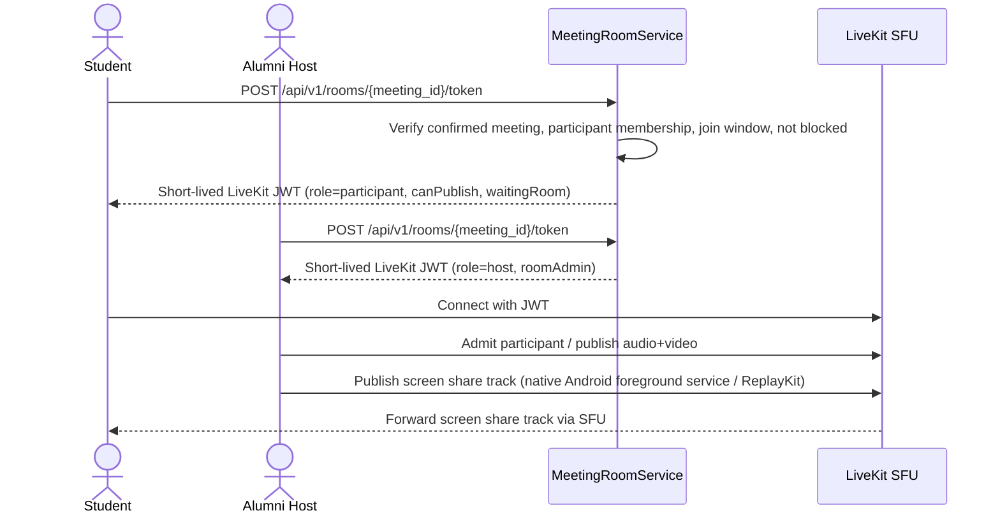

### 3.7 AI Mentor Recommendation, Scheduling with Approval & Provider Invocation
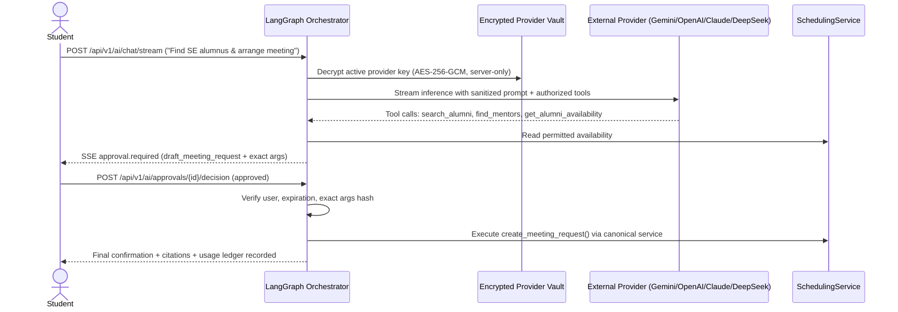

---

## 4. Canonical State Machines

### 4.1 Meeting Request State Machine
- `PENDING` -> `ACCEPTED` (triggers atomic `meetings` creation)
- `PENDING` -> `DECLINED`
- `PENDING` -> `COUNTER_PROPOSED`
- `PENDING` -> `CANCELLED` (by student)
- `PENDING` -> `EXPIRED` (slots elapsed)
- `COUNTER_PROPOSED` -> `ACCEPTED` (student confirms counter slot)
- `COUNTER_PROPOSED` -> `DECLINED`
- `COUNTER_PROPOSED` -> `CANCELLED`
- `COUNTER_PROPOSED` -> `EXPIRED`
Terminal states: `ACCEPTED`, `DECLINED`, `CANCELLED`, `EXPIRED`.

### 4.2 Confirmed Meeting State Machine
- `SCHEDULED` -> `IN_PROGRESS` (first participant/host joins room)
- `SCHEDULED` -> `CANCELLED` (explicit actor & reason)
- `SCHEDULED` -> `NO_SHOW` (window elapsed without join)
- `IN_PROGRESS` -> `COMPLETED` (host ends or timeout)
- `IN_PROGRESS` -> `CANCELLED` (aborted)
Rescheduling creates a new `meeting_requests` / `meetings` linked via `rescheduled_from_meeting_id` and marks the superseded meeting `CANCELLED` atomically.

### 4.3 Meeting Room State Machine
- `WAITING` -> `ACTIVE` -> `ENDED` (plus `EXPIRED` on room TTL).

### 4.4 Message Delivery State Machine
- Client local: `QUEUED_OFFLINE` -> `SENDING` -> Server durable: `SENT` -> `DELIVERED` -> `READ` (or `FAILED_RETRYABLE`).

### 4.5 AI Approval State Machine
- `pending` -> `approved` -> `executed` (or `execution_failed`)
- `pending` -> `rejected`
- `pending` -> `expired`
Arguments are SHA-256 hashed (`args_hash`) at creation and verified upon execution so modified arguments are rejected.

---

## 5. Architectural Decisions Summary (ADRs)
See `docs/architecture/adr/` for full ADRs approving:
- **ADR-001:** Retain FastAPI Modular Monolith + PostgreSQL/Supabase.
- **ADR-002:** PostgreSQL GIST Exclusion Constraints & Transactional Outbox for Scheduling.
- **ADR-003:** FastAPI WebSocket + Redis Pub/Sub (PostgreSQL as Durable Store).
- **ADR-004:** LiveKit SFU & Expo SDK 52 Native Compatibility Policy.
- **ADR-005:** Multi-Provider AI Abstraction, AES-256-GCM Encrypted Vault & SSE Streaming.
