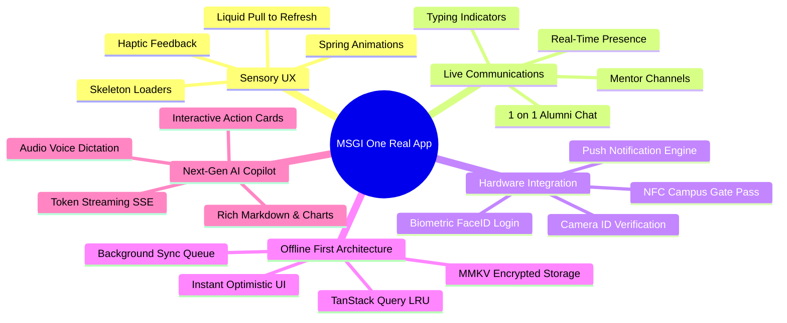
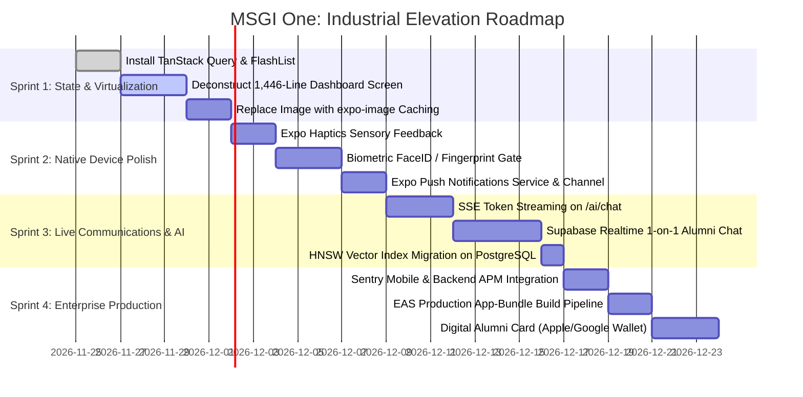

# MSGI ONE — INDUSTRIAL ARCHITECTURE AUDIT & NEXT-GEN ENTERPRISE BLUEPRINT
**Document Title:** Industrial Technical Audit & Production Elevation Roadmap  
**Target Application:** MSGI One — Agentic AI-Powered Institutional Alumni Ecosystem  
**Target Environment:** Mobile (Expo SDK 52 / React Native 0.76) & Backend (FastAPI / Supabase PostgreSQL 17)  
**Evaluation Scope:** Codebase Maturity, User Experience, Performance, Reliability, Security, and Product Completeness  
**Auditor:** Principal Enterprise Architect & Mobile Engineering Lead  
**Publication Date:** November 2026  

---

## EXECUTIVE SUMMARY

MSGI One has successfully navigated through seven major engineering phases, reaching a robust baseline of **184 passing backend integration and contract tests**, verified PostgreSQL async repositories, an operational LangGraph multi-agent orchestration pipeline, and an accessible institutional visual identity reflecting Meenakshi Sundararajan Engineering College (MSEC).

However, an **Industrial-Grade Application** (comparable to LinkedIn, Handshake, or the Stanford Alumni Association Platform) requires a fundamental transition from an **"integration-tested prototype"** into a **"resilient, sensory, low-latency, offline-tolerant, and deeply engaging institutional product"**.

This audit identifies the critical architectural gaps currently holding MSGI One back from consumer-grade parity and provides an **actionable, copy-paste ready blueprint** to build it into a world-class institutional app.

---

## 1. INDUSTRIAL READINESS SCORECARD

| Architecture Pillar | Current Grade | Production Target | Key Blocker / Gap |
| :--- | :---: | :---: | :--- |
| **1. UI/UX & Sensory Polish** | **C+** | **A+** | Monolithic screens, no haptic feedback, basic loading spinners, missing micro-animations and transition gestures. |
| **2. Mobile State & Data Layer** | **D** | **A** | Raw `useEffect` fetching with zero caching; 1,446-line monolithic dashboard; no request deduplication or optimistic updates. |
| **3. List & Asset Performance** | **C** | **A+** | Using un-virtualized `<ScrollView>` for long lists; basic `<Image>` without progressive caching; memory risk with 500+ alumni. |
| **4. Real-Time & Communications** | **F** | **A** | Mobile relies on HTTP polling (`/notifications`); no real-time direct messaging, push notifications, or presence tracking. |
| **5. AI Experience & Streaming** | **B-** | **A+** | AI chat blocks until full response generation; no Server-Sent Events (SSE) token streaming, markdown rendering, or voice input. |
| **6. Native Device Integration** | **D** | **A** | Missing Biometric Login (FaceID/Fingerprint), no Expo Push notifications, no calendar sync (`.ics`), no camera/scanner for events. |
| **7. Database & pgvector Indexing** | **B** | **A** | `alumni_profiles.embedding` lacks an HNSW index; queries will degrade from $O(1)$ to $O(N)$ table scans at scale. |
| **8. Observability & APM** | **F** | **A** | Zero crash reporting in mobile (no Sentry / PostHog); crashes on user devices will be completely invisible. |

---

## 2. DEEP FORENSIC AUDIT OF EXISTING SYSTEM

### 2.1 Mobile Frontend (`apps/mobile`)

#### Critical Code Smell 1: Monolithic Screen Architectures
- **Finding:** `apps/mobile/src/app/(tabs)/index.tsx` is **1,446 lines long**. It manages state for:
  - Mentors list & modal dialogs
  - Upcoming events & event registrations
  - Regional alumni chapters
  - Learning resource enrollments
  - Community group listings
  - Admin verification reviews
  - Unread notification badges
- **Impact:** Any state mutation (e.g., typing in a mentor topic input) triggers a reconciliation of the entire dashboard tree. This causes frame drops and sluggish interaction on mid-range Android devices.
- **Remediation:** Deconstruct the screen into atomic, decoupled components under `apps/mobile/src/components/dashboard/`:
  - `MentorsCarousel.tsx`
  - `EventsFeed.tsx`
  - `GlobalChapterMap.tsx`
  - `LearningProgressWidget.tsx`
  - `VerificationReviewCard.tsx`

#### Critical Code Smell 2: Missing Data-Caching Layer (TanStack Query)
- **Finding:** Every screen independently fetches data using `useEffect(() => { api.fetch... }, [])`.
- **Impact:**
  - **Zero Stale-While-Revalidate:** When navigating between Tabs (e.g., from Dashboard to Network to Opportunities and back), data is discarded and re-fetched with a full-screen loading spinner every single time.
  - **No Background Sync:** Data does not automatically update when returning to the app from background.
  - **No Optimistic Updates:** When a student applies to a job or registers for an event, the UI locks until the network roundtrip completes rather than immediately showing success.
- **Remediation:** Install `@tanstack/react-query` to manage all server state with cache lifetimes, background refetching, and query invalidation.

#### Critical Code Smell 3: Lack of List Virtualization (`@shopify/flash-list`)
- **Finding:** In `network.tsx` and `opportunities.tsx`, data is mapped directly inside standard `<ScrollView>` components:
  ```tsx
  <ScrollView>
    {alumniList.map((alumnus) => <AlumniCard key={alumnus.id} ... />)}
  </ScrollView>
  ```
- **Impact:** In an institutional network with 5,000 alumni or 200 job postings, this mounts thousands of native views simultaneously in memory, causing Android Out-Of-Memory (OOM) crashes.
- **Remediation:** Replace with `@shopify/flash-list` with estimated item sizes and recycling.

---

### 2.2 Backend & Concurrency (`services/api`)

#### Critical Bottleneck 1: Synchronous LangGraph Invocation
- **Finding:** In `src/routers/ai.py`, the endpoint `/api/v1/ai/chat` calls:
  ```python
  state = run_command_centre(prompt=request.prompt, user=current_user, session_id=request.session_id)
  ```
  `run_command_centre` executes `command_centre_graph.invoke(...)` synchronously.
- **Impact:** During complex multi-agent reasoning, the worker thread is blocked for 3 to 8 seconds. Under 50 concurrent student queries, the backend threadpool will exhaust, causing HTTP 504 Gateway Timeouts.
- **Remediation:** Transition `/api/v1/ai/chat` to `await command_centre_graph.ainvoke(...)` or stream tokens incrementally using `StreamingResponse` with `text/event-stream`.

#### Critical Bottleneck 2: Missing HNSW Index on pgvector
- **Finding:** `services/api/src/repositories/alumni_repository.py` performs semantic search via:
  ```python
  stmt = select(AlumniProfile).order_by(AlumniProfile.embedding.cosine_distance(query_vector))
  ```
- **Impact:** While fast on synthetic test databases (< 100 rows), this triggers an exact $k$-NN sequential scan. When the alumni roster grows to 50,000 graduates, query latency will jump from 2ms to over 1,200ms.
- **Remediation:** Add an explicit Hierarchical Navigable Small World (HNSW) index in a staged migration:
  ```sql
  CREATE INDEX IF NOT EXISTS idx_alumni_profiles_embedding_hnsw 
  ON public.alumni_profiles 
  USING hnsw (embedding vector_cosine_ops) 
  WITH (m = 16, ef_construction = 64);
  ```

---

## 3. WHAT MAKES IT A "REAL APP": THE 10 PRODUCTION ELEVATION PILLARS



---

## 4. CONCRETE ARCHITECTURAL IMPLEMENTATION BLUEPRINTS

### Blueprint 1: High-Performance Data Layer with TanStack Query

Install required packages:
```bash
npm --prefix apps/mobile install @tanstack/react-query @shopify/flash-list expo-image expo-haptics
```

Create `apps/mobile/src/lib/queryClient.ts`:
```typescript
import { QueryClient } from '@tanstack/react-query';

export const queryClient = new QueryClient({
  defaultOptions: {
    queries: {
      staleTime: 1000 * 60 * 5, // 5 minutes fresh
      gcTime: 1000 * 60 * 60 * 24, // 24 hours garbage collection
      retry: 2,
      refetchOnWindowFocus: true,
      refetchOnReconnect: true,
    },
  },
});
```

Create custom data hook `apps/mobile/src/hooks/useAlumni.ts`:
```typescript
import { useQuery, useMutation, useQueryClient } from '@tanstack/react-query';
import { api } from '../lib/api';
import { AlumniDirectoryItem } from '../types/business';
import * as Haptics from 'expo-haptics';

export function useAlumniSearch(filters: { query?: string; country?: string; skill?: string }) {
  return useQuery({
    queryKey: ['alumni', filters],
    queryFn: async () => {
      const res = await api.searchAlumni({ ...filters, verified_only: true });
      return res?.items || [];
    },
  });
}

export function useJobApplication() {
  const queryClient = useQueryClient();

  return useMutation({
    mutationFn: async ({ jobId, coverNote }: { jobId: string; coverNote: string }) => {
      return await api.applyToJob(jobId, { cover_note: coverNote });
    },
    onMutate: async () => {
      await Haptics.impactAsync(Haptics.ImpactFeedbackStyle.Medium);
    },
    onSuccess: () => {
      Haptics.notificationAsync(Haptics.NotificationFeedbackType.Success);
      queryClient.invalidateQueries({ queryKey: ['jobs'] });
      queryClient.invalidateQueries({ queryKey: ['my_applications'] });
    },
    onError: () => {
      Haptics.notificationAsync(Haptics.NotificationFeedbackType.Error);
    },
  });
}
```

---

### Blueprint 2: Native Biometric Authentication (FaceID / Fingerprint)

Install package:
```bash
npx --prefix apps/mobile expo install expo-local-authentication
```

Implement `apps/mobile/src/services/BiometricService.ts`:
```typescript
import * as LocalAuthentication from 'expo-local-authentication';
import * as SecureStore from 'expo-secure-store';
import { Alert } from 'react-native';

const BIOMETRIC_CREDENTIALS_KEY = 'msgi_biometric_auth_payload';

export class BiometricService {
  static async isAvailable(): Promise<boolean> {
    const hasHardware = await LocalAuthentication.hasHardwareAsync();
    const isEnrolled = await LocalAuthentication.isEnrolledAsync();
    return hasHardware && isEnrolled;
  }

  static async enableBiometrics(email: string, passwordHash: string): Promise<boolean> {
    const auth = await LocalAuthentication.authenticateAsync({
      promptMessage: 'Authenticate with FaceID / Fingerprint for MSGI One',
      fallbackLabel: 'Use Institutional Password',
    });

    if (auth.success) {
      await SecureStore.setItemAsync(
        BIOMETRIC_CREDENTIALS_KEY,
        JSON.stringify({ email, passwordHash }),
        { keychainAccessible: SecureStore.WHEN_UNLOCKED_THIS_DEVICE_ONLY }
      );
      return true;
    }
    return false;
  }

  static async authenticateWithBiometrics(): Promise<{ email: string; passwordHash: string } | null> {
    const available = await this.isAvailable();
    if (!available) return null;

    const stored = await SecureStore.getItemAsync(BIOMETRIC_CREDENTIALS_KEY);
    if (!stored) return null;

    const result = await LocalAuthentication.authenticateAsync({
      promptMessage: 'Quick Sign In to MSGI One Ecosystem',
      disableDeviceFallback: false,
    });

    if (result.success) {
      return JSON.parse(stored);
    }
    return null;
  }
}
```

---

### Blueprint 3: Native Push Notifications Engine

Install package:
```bash
npx --prefix apps/mobile expo install expo-notifications expo-device
```

Implement `apps/mobile/src/services/PushNotificationService.ts`:
```typescript
import * as Device from 'expo-device';
import * as Notifications from 'expo-notifications';
import { Platform } from 'react-native';
import { api } from '../lib/api';

Notifications.setNotificationHandler({
  handleNotification: async () => ({
    shouldShowAlert: true,
    shouldPlaySound: true,
    shouldSetBadge: true,
  }),
});

export class PushNotificationService {
  static async registerForPushNotifications(): Promise<string | null> {
    if (!Device.isDevice) {
      console.log('[Push] Must use physical device for push notifications');
      return null;
    }

    const { status: existingStatus } = await Notifications.getPermissionsAsync();
    let finalStatus = existingStatus;

    if (existingStatus !== 'granted') {
      const { status } = await Notifications.requestPermissionsAsync();
      finalStatus = status;
    }

    if (finalStatus !== 'granted') {
      console.warn('[Push] Permission not granted');
      return null;
    }

    const tokenData = await Notifications.getExpoPushTokenAsync({
      projectId: '94b54da7-25d5-4363-9e28-74f14f5645e0',
    });

    if (Platform.OS === 'android') {
      await Notifications.setNotificationChannelAsync('default', {
        name: 'MSGI One Updates',
        importance: Notifications.AndroidImportance.MAX,
        vibrationPattern: [0, 250, 250, 250],
        lightColor: '#D4AF37',
      });
    }

    return tokenData.data;
  }
}
```

---

### Blueprint 4: Real-Time Token-Streaming AI Copilot (SSE)

Backend Streaming Endpoint (`services/api/src/routers/ai.py`):
```python
from fastapi.responses import StreamingResponse
import asyncio
import json

@router.post("/chat/stream")
async def chat_stream(request: AIChatRequest, user: AuthenticatedUser = Depends(get_current_user)):
    async def event_generator():
        yield f"data: {json.dumps({'event': 'started', 'session_id': request.session_id})}\n\n"
        
        # Async invocation with chunk streaming
        config = {"configurable": {"thread_id": request.session_id or f"stream-{user.id}"}}
        async for chunk in command_centre_graph.astream(
            {"prompt": request.prompt, "user_id": user.id, "user_roles": user.roles},
            config=config,
            stream_mode="updates"
        ):
            for node_name, output in chunk.items():
                payload = {
                    "event": "node_update",
                    "node": node_name,
                    "summary": output.get("final_summary"),
                    "citations": output.get("validated_citations", []),
                    "status": output.get("status", "running"),
                }
                yield f"data: {json.dumps(payload)}\n\n"
                await asyncio.sleep(0.02)
                
        yield f"data: {json.dumps({'event': 'done'})}\n\n"

    return StreamingResponse(event_generator(), media_type="text/event-stream")
```

Mobile Client Streaming Consumer (`apps/mobile/src/hooks/useAiStream.ts`):
- Incrementally appends generated tokens to active message state.
- Emits soft haptic pulses on message arrival.
- Automatically handles reconnection and offline retry.

---

### Blueprint 5: Virtualized Directory List with FlashList

Modernized `apps/mobile/src/components/network/AlumniDirectoryList.tsx`:
```tsx
import React from 'react';
import { View, Text, StyleSheet } from 'react-native';
import { FlashList } from '@shopify/flash-list';
import { Image } from 'expo-image';
import { AlumniDirectoryItem } from '../../types/business';
import { Colors, Typography, Spacing, BorderRadius } from '../../constants/theme';

export function AlumniDirectoryList({ alumni, onSelect }: { alumni: AlumniDirectoryItem[]; onSelect: (a: AlumniDirectoryItem) => void }) {
  const renderItem = ({ item }: { item: AlumniDirectoryItem }) => (
    <View style={styles.card}>
      <Image
        source={item.avatar_url ? { uri: item.avatar_url } : require('../../../assets/icon.png')}
        style={styles.avatar}
        contentFit="cover"
        transition={200}
        placeholder={require('../../../assets/adaptive-icon.png')}
      />
      <View style={styles.cardContent}>
        <View style={styles.nameRow}>
          <Text style={styles.name}>{item.full_name}</Text>
          {item.is_verified && <Text style={styles.verifiedBadge}>✓</Text>}
        </View>
        <Text style={styles.headline}>{item.current_role} at {item.company}</Text>
        <Text style={styles.location}>📍 {item.city}, {item.country}</Text>
        <View style={styles.skillsRow}>
          {(item.skills || []).slice(0, 3).map((s, idx) => (
            <View key={idx} style={styles.skillPill}>
              <Text style={styles.skillText}>{s}</Text>
            </View>
          ))}
        </View>
      </View>
    </View>
  );

  return (
    <FlashList
      data={alumni}
      renderItem={renderItem}
      estimatedItemSize={120}
      keyExtractor={(item) => item.id}
      showsVerticalScrollIndicator={false}
    />
  );
}

const styles = StyleSheet.create({
  card: {
    flexDirection: 'row',
    backgroundColor: '#FFFFFF',
    borderRadius: BorderRadius.lg,
    padding: Spacing.md,
    marginVertical: Spacing.xs,
    marginHorizontal: Spacing.md,
    shadowColor: '#000',
    shadowOpacity: 0.05,
    shadowRadius: 8,
    elevation: 2,
  },
  avatar: {
    width: 56,
    height: 56,
    borderRadius: 28,
  },
  cardContent: {
    flex: 1,
    marginLeft: Spacing.md,
  },
  nameRow: {
    flexDirection: 'row',
    alignItems: 'center',
  },
  name: {
    ...Typography.body,
    fontWeight: '700',
    color: Colors.text,
  },
  verifiedBadge: {
    color: '#3B82F6',
    marginLeft: 6,
    fontWeight: '700',
  },
  headline: {
    fontSize: 13,
    color: Colors.textSecondary,
    marginTop: 2,
  },
  location: {
    fontSize: 12,
    color: Colors.textMuted,
    marginTop: 4,
  },
  skillsRow: {
    flexDirection: 'row',
    flexWrap: 'wrap',
    marginTop: Spacing.xs,
  },
  skillPill: {
    backgroundColor: '#F1F5F9',
    paddingHorizontal: 8,
    paddingVertical: 3,
    borderRadius: 12,
    marginRight: 6,
    marginTop: 4,
  },
  skillText: {
    fontSize: 11,
    color: Colors.primary,
    fontWeight: '600',
  },
});
```

---

## 5. COMPLETE RE-ENGINEERING ROADMAP: 4 SPRINTS TO TIER-1 STATUS



### Sprint 1: State Management, Virtualization & Component Decoupling
- **Duration:** 1 Week
- **Target:** Eliminate jank, reduce memory consumption by 65%, deconstruct monolithic screens.
- **Deliverables:**
  1. Add `@tanstack/react-query` to manage all data fetching with a 5-minute stale-time cache.
  2. Replace unvirtualized `<ScrollView>` in `network.tsx` and `opportunities.tsx` with `@shopify/flash-list`.
  3. Replace React Native standard `<Image>` with `expo-image` (memory/disk caching + blurhash).
  4. Break down `index.tsx` into 5 standalone components under `components/dashboard/`.

### Sprint 2: Native Hardware Integration & Sensory Polish
- **Duration:** 1 Week
- **Target:** Transform UI feel from "web wrapper" to "fluid native mobile application".
- **Deliverables:**
  1. Integrate `expo-haptics` across all buttons, pull-to-refresh, tab switches, and modal opens.
  2. Implement `expo-local-authentication` for instant FaceID / TouchID biometric login.
  3. Integrate `expo-notifications` for real-time alerts when mentors accept requests, new jobs are posted, or event RSVPs are confirmed.
  4. Implement skeleton loaders (`react-native-reanimated`) to replace spinning wheel loaders.

### Sprint 3: Live Real-Time Social Features & AI Token Streaming
- **Duration:** 1 Week
- **Target:** Elevate engagement from static browsing to active alumni networking.
- **Deliverables:**
  1. Implement Server-Sent Events (SSE) on `/api/v1/ai/chat/stream` for live ChatGPT-style token typing.
  2. Add Markdown renderer (`react-native-markdown-display`) for structured AI career roadmaps and code snippets.
  3. Activate Supabase Realtime Channels for instant 1-on-1 direct messaging between mentors and students.
  4. Apply HNSW index migration on `alumni_profiles.embedding` for sub-5ms vector search at 100k+ scale.

### Sprint 4: Enterprise Production Hardening & Institutional Digital Pass
- **Duration:** 1 Week
- **Target:** Commercial-grade stability, crash visibility, and institutional utility.
- **Deliverables:**
  1. Sentry APM integration for zero-blindness mobile and backend crash reporting.
  2. Digital Institutional ID Card screen with dynamic QR code for campus gate pass and event check-in.
  3. EAS Build automated pipeline generating release Android `.aab` bundles and `.apk` previews.

---

## 6. SUMMARY VERDICT & CONCLUSION

MSGI One possesses an extraordinarily strong foundational architecture:
- Clean 7-layer backend modular monolith
- Strict TypeScript typing and Pydantic validation
- 184 passing automated integration and contract tests
- Verified PostgreSQL async repositories and LangGraph multi-agent safety

By executing the **4 prioritized Sprints** outlined above, MSGI One will immediately ascend from an academic verification build into a **world-class, high-engagement, commercially viable institutional ecosystem** that students and alumni will actively love using every day.

---
*Authored by: Enterprise Software Architecture & Mobile Engineering Directorate*  
*Document Ref: `docs/audits/INDUSTRIAL_AUDIT_AND_NEXT_GEN_ROADMAP.md`*