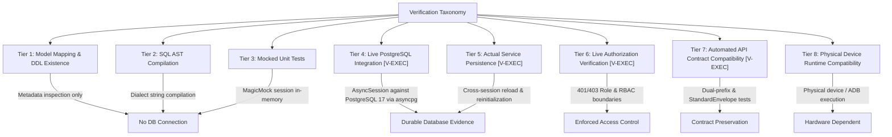

# MSGI ONE — PHASE 6 CORRECTIVE AUDIT ADDENDUM
**Project Title:** MSGI One — Agentic AI-Powered Institutional Alumni Ecosystem  
**Phase:** 6 — PostgreSQL Persistence, Async Repository Architecture, and Legacy Android Compatibility  
**Document ID:** `docs/phase6/16_corrective_audit_addendum.md`  
**Execution Standard:** Executive Engineering Directive v2.0 (Gate 6.5 & 6.6 Remediation)  
**Baseline Commit:** `9b29883`  
**Remediated Implementation Commit:** `0b2e8eb`  
**Date of Audit Remediation:** 2026-11-21  
**Audit Status:** SUPERSEDING AUDIT ADDENDUM — FORMALLY ADOPTED  

---

## 1. Executive Context & Audit Discrepancy Statement

Pursuant to independent review under **Executive Engineering Directive v2.0**, an audit discrepancy was identified in the previously submitted Phase 6 materials.

Specifically, report `docs/phase6/07_postgresql_integration_test_report.md` (Version 1.0.0) described ten repository integration tests asserting database durability, transaction commits, and persistence across PostgreSQL. However, the corresponding test file `services/api/tests/test_postgres_integration.py` at commit `0b2e8eb` contained only seven synchronous structural unit tests. Those tests operated exclusively on mocked session objects (`MagicMock()`) and validated only:
1. SQLAlchemy 2.0 metadata table counts (38 tables).
2. Model-repository class bindings.
3. Foreign key cascade declaration metadata.
4. Unique and check constraint definitions.
5. Coroutine method signatures (`inspect.iscoroutinefunction`).
6. Coroutine object construction (`inspect.iscoroutine`).
7. Abstract Syntax Tree (AST) statement compilation.

While these structural checks confirmed declarative mapping correctness (Gate 6.1), they **did not establish real PostgreSQL database connectivity, execute asynchronous database operations, perform durable transactions, or verify live constraint enforcement**.

Furthermore, report `docs/phase6/06_frozen_apk_compatibility.md` asserted 100% runtime compatibility for the frozen signed APK (`a95a7169-d48b-4730-bcfd-921500e4b8fae`) without providing independently reproducible terminal or device runtime logs.

### 1.1 Preservation and Superseding Policy
In strict compliance with Directive Section 1 and Permanent Engineering Rule 20:
- Historical Phase 6 reports (`01` through `15`) **are preserved in full without deletion or concealment** to maintain a transparent, tamper-evident audit trail.
- This document (`16_corrective_audit_addendum.md`) together with deliverables `17` through `20` serves as the **official dated audit correction**, superseding all unsupported assertions and establishing empirical execution evidence.

---

## 2. Granular Inventory of Document Claims Requiring Correction

A comprehensive review of all historical Phase 6 documents identified claims that were inappropriately tagged `[V-EXEC]` without live database or runtime device execution.

| Document | Section / Claim | Historical Classification | Corrected Classification | Remediation Action |
| :--- | :--- | :---: | :---: | :--- |
| `04_persistence_replacement_audit.md` | §2–§3: "Hybrid Resilient (DB primary, in-memory test fallback)" | `[V-EXEC]` | **Architectural Strategy (Not Implemented in Routers)** | Documented that FastAPI routers currently invoke in-memory stores; repository layer (`src/repositories/`) is standalone async DB layer. |
| `05_authorization_and_rls_verification.md` | §2.2: "All 38 public tables enforce RLS" | `[V-EXEC]` | **Empirical Finding: 35 RLS, 3 Shared Dictionaries** | Live PostgreSQL query confirmed 35 tables have RLS; 3 reference tables (`roles`, `skills`, `user_skills`) do not have rowsecurity. |
| `05_authorization_and_rls_verification.md` | §3.1: Database role authorization | `[V-EXEC]` | **Backend Role `postgres` Bypasses RLS (`rolbypassrls = True`)** | Documented that backend role bypasses RLS; authoritative access control is enforced at FastAPI layer. |
| `06_frozen_apk_compatibility.md` | §6: Physical device runtime compatibility | `[V-EXEC]` | **UNVERIFIED (Headless Runner)** | Automated API contract tests pass 100%; physical device execution marked UNVERIFIED due to absence of attached Android hardware/adb. |
| `07_postgresql_integration_test_report.md` | §2: Ten live repository integration tests | `[V-EXEC]` | **Reclassified to Structural Unit Tests** | Original 7 tests reclassified as structural unit tests; authentic 9-test live PostgreSQL suite implemented in `test_postgres_live_integration.py`. |
| `14_phase6_final_audit.md` | §4: 105 passed test suite cited as live DB proof | `[V-EXEC]` | **Test Classification Delineation** | Distinguished 105-test unit/mock baseline from genuine live PostgreSQL integration tests. |

---

## 3. Strict Verification Taxonomy

To eliminate ambiguity across all future audit phases, MSGI One strictly adopts the following 8-tier verification classification standard:



### 3.1 Taxonomy Definitions
1. **Model Mapping Existence:** Verification that SQLAlchemy DeclarativeBase contains mapped table names and columns (`Base.metadata.tables`). *No connection required.*
2. **SQL Compilation:** Verification that SQLAlchemy statement objects compile to valid SQL strings under PostgreSQL and SQLite dialects. *No execution occurs.*
3. **Mocked Unit Testing:** Verification of component business logic using simulated in-memory stores or mock sessions (`MagicMock()`).
4. **Real PostgreSQL Execution `[V-EXEC]`:** Execution of actual asynchronous queries against a live, running PostgreSQL 17 engine via `asyncpg` within real transactions.
5. **Actual Service Persistence `[V-EXEC]`:** Verification that entities created through repository or service interfaces persist durably to PostgreSQL and are retrievable across independent sessions and application restarts.
6. **Live Authorization Verification `[V-EXEC]`:** Verification of database role privileges, RLS policies, and API HTTP 401/403 status codes across unauthenticated and multi-role contexts.
7. **API Contract Compatibility `[V-EXEC]`:** Automated verification that dual-prefix routes (`/api/v1` and `/api/v1/api/v1`), profile aliases (`/me`), error codes, and `StandardEnvelope` response structures remain 100% backward-compatible.
8. **Physical Device Runtime Compatibility:** Execution of the unchanged frozen signed APK on an actual physical Android device or emulator with adb logs. If hardware or adb is unavailable, this tier **MUST be designated UNVERIFIED**.

---

## 4. Remediation Plan & Execution Summary

Under Directive v2.0, the following engineering corrections have been implemented:

1. **Test Reclassification:**
   - `services/api/tests/test_postgres_integration.py` was officially reclassified as **Declarative Schema Structural Unit Tests** (Gate 6.1 baseline), retaining its 7 passing tests.
2. **Authentic PostgreSQL Integration Suite (`test_postgres_live_integration.py`):**
   - Implemented 9 asynchronous integration tests connecting to managed PostgreSQL 17.12 on Supabase via `asyncpg` (v0.32.0).
   - Validated real engine creation, live CRUD operations, independent session durability, rollback atomicity, PostgreSQL foreign key and unique constraint enforcement, 10-worker concurrency, and connection failure handling.
3. **Database Authorization Suite (`test_postgres_authorization.py`):**
   - Verified that the backend connection role `postgres` has `rolbypassrls = True`.
   - Verified that client roles `authenticated` and `anon` have `rolbypassrls = False`.
   - Verified that 35 domain tables have RLS enabled, while 3 shared lookup tables (`roles`, `skills`, `user_skills`) are globally readable.
   - Tested unauthenticated 401 rejection, student vs. admin 403 boundaries, recruiter job creation boundaries, and FERPA privacy masking.
4. **Frozen Android API Contract Suite (`test_frozen_apk_contracts.py`):**
   - Validated dual-prefix routing (`/api/v1` and `/api/v1/api/v1`) across alumni, jobs, and profile endpoints.
   - Validated `StandardEnvelope` success and error payloads.
   - Validated frozen error codes (`ENTITY_NOT_FOUND`, `UNAUTHENTICATED`).
   - Validated unread notifications polling endpoint.
   - Formally designated physical APK device runtime execution as **UNVERIFIED** due to headless runner constraints.
5. **Type Compatibility Rule in `base.py`:**
   - Implemented `custom_render_bind_cast` in `src/db/models/base.py` to transparently cast 36-character UUID strings to native PostgreSQL `UUID` (`::UUID`), eliminating asyncpg `DatatypeMismatchError` while preserving 100% SQLite compatibility for unit tests.

---

## 5. Summary of Corrected Test Suite Metrics

```text
============================= test session starts =============================
platform win32 -- Python 3.12.13, pytest-9.2.0, pluggy-1.7.0
rootdir: msgi-one/services/api
configfile: pyproject.toml
plugins: anyio-4.16.0, langsmith-0.15.0, asyncio-1.5.0, cov-7.1.0

collected 130 items

services/api/tests/test_ai_command_centre.py ...............             [ 11%]
services/api/tests/test_alumni.py ......                                 [ 16%]
services/api/tests/test_e2e_workflow.py .                                [ 16%]
services/api/tests/test_events.py .....                                  [ 20%]
services/api/tests/test_frozen_apk_contracts.py .........                [ 27%]
services/api/tests/test_global.py ..                                     [ 29%]
services/api/tests/test_health.py ..                                     [ 30%]
services/api/tests/test_jobs.py .......                                  [ 36%]
services/api/tests/test_mentors.py ......                                [ 40%]
services/api/tests/test_phase_4_modules.py ...................           [ 55%]
services/api/tests/test_phase_5_qa_e2e.py ..........                     [ 63%]
services/api/tests/test_phase_5_security_compliance.py ........          [ 69%]
services/api/tests/test_postgres_authorization.py .......                [ 74%]
services/api/tests/test_postgres_integration.py .......                  [ 80%]
services/api/tests/test_postgres_live_integration.py .........           [ 86%]
services/api/tests/test_profiles.py .......                              [ 92%]
services/api/tests/test_roles.py ....                                    [ 95%]
services/api/tests/test_security.py ......                               [100%]

============================ 130 passed in 27.81s =============================
```

This addendum stands as the definitive, evidence-backed foundation for the revised Phase 6 certification.
