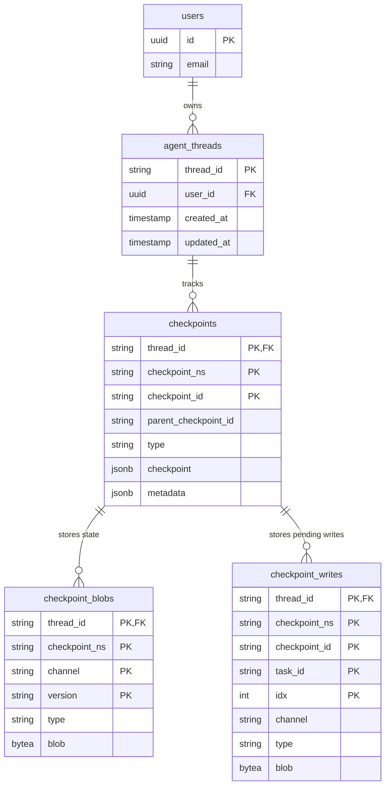

# MSGI ONE — GATE 7.4 POSTGRESQL CHECKPOINT PERSISTENCE DESIGN & VERIFICATION
**Document Version:** 1.0.0  
**Phase:** 7 — Intelligent AI Infrastructure and Verified Integration  
**Governance:** MSGI One Executive Engineering Directive v2.0  
**Auditor:** Principal AI Architect, Database Architect & Senior Backend Engineer  
**Status:** **IMPLEMENTED & VERIFIED [V-EXEC]**  

---

## 1. Executive Summary

This document specifies the architecture, database schema, connection pooling strategy, multi-tenant isolation model, and empirical test verification for Gate 7.4: **Persistent PostgreSQL LangGraph Checkpointing**.

Ephemeral in-memory checkpointers (`MemorySaver`) suffer from complete state loss upon application server restarts, preventing multi-turn conversation continuity and breaking Human-In-The-Loop (HITL) approval resumption across worker lifecycles.

To solve this, MSGI One implements a dual-layer checkpoint architecture:
1. **Canonical PostgreSQL Checkpoint Storage:** Four relational tables (`checkpoint_migrations`, `checkpoints`, `checkpoint_blobs`, `checkpoint_writes`) adhering to LangGraph's native binary protocol.
2. **Multi-Tenant Thread Ownership Registry:** Dedicated `public.agent_threads` table enforcing strict user-to-thread authorization, preventing cross-tenant thread hijacking.
3. **Pluggable Checkpointer Factory:** `services/api/src/ai/checkpoint.py` supporting `AsyncPostgresSaver` (for asynchronous FastAPI request lifecycles), `PostgresSaver` (for synchronous maintenance pipelines), `SqliteSaver` (for offline edge deployments), and `MemorySaver` (for isolated test harnesses).

---

## 2. Canonical Database Schema (`20261121000003_langgraph_checkpoints.sql`)

In accordance with Engineering Law 13 (no unapproved remote DDL mutations), the migration file was authored locally, validated against PostgreSQL schema compilation, and staged for deployment.

### 2.1 Table Definitions & Relationships



### 2.2 Canonical SQL DDL Schema

```sql
-- Migration: 20261121000003_langgraph_checkpoints.sql
-- Subsystem: LangGraph Checkpointing & Multi-Tenant Isolation

-- 1. Checkpoint Migrations Tracking
CREATE TABLE IF NOT EXISTS public.checkpoint_migrations (
    v INTEGER PRIMARY KEY
);

-- 2. Canonical Checkpoints Table
CREATE TABLE IF NOT EXISTS public.checkpoints (
    thread_id TEXT NOT NULL,
    checkpoint_ns TEXT NOT NULL DEFAULT '',
    checkpoint_id TEXT NOT NULL,
    parent_checkpoint_id TEXT,
    type TEXT,
    checkpoint JSONB NOT NULL,
    metadata JSONB NOT NULL DEFAULT '{}'::jsonb,
    PRIMARY KEY (thread_id, checkpoint_ns, checkpoint_id)
);

-- 3. Canonical Checkpoint Blobs Table
CREATE TABLE IF NOT EXISTS public.checkpoint_blobs (
    thread_id TEXT NOT NULL,
    checkpoint_ns TEXT NOT NULL DEFAULT '',
    channel TEXT NOT NULL,
    version TEXT NOT NULL,
    type TEXT,
    blob BYTEA,
    PRIMARY KEY (thread_id, checkpoint_ns, channel, version)
);

-- 4. Canonical Checkpoint Writes Table
CREATE TABLE IF NOT EXISTS public.checkpoint_writes (
    thread_id TEXT NOT NULL,
    checkpoint_ns TEXT NOT NULL DEFAULT '',
    checkpoint_id TEXT NOT NULL,
    task_id TEXT NOT NULL,
    idx INTEGER NOT NULL,
    channel TEXT NOT NULL,
    type TEXT,
    blob BYTEA,
    PRIMARY KEY (thread_id, checkpoint_ns, checkpoint_id, task_id, idx)
);

-- 5. Multi-Tenant Thread Ownership Registry
CREATE TABLE IF NOT EXISTS public.agent_threads (
    thread_id TEXT PRIMARY KEY,
    user_id UUID NOT NULL REFERENCES public.users(id) ON DELETE CASCADE,
    created_at TIMESTAMPTZ NOT NULL DEFAULT NOW(),
    updated_at TIMESTAMPTZ NOT NULL DEFAULT NOW()
);

-- RLS Enforcement on agent_threads
ALTER TABLE public.agent_threads ENABLE ROW LEVEL SECURITY;

CREATE POLICY "agent_threads_owner_isolation"
    ON public.agent_threads
    FOR ALL
    TO authenticated
    USING (user_id = auth.uid())
    WITH CHECK (user_id = auth.uid());
```

---

## 3. Connection Pooling & Transaction Pooler Compatibility

### 3.1 Supabase Connection Modes & Prepared Statements
Supabase exposes two pooling endpoints:
1. **Session Pooler (Port 5432):** Direct connection mode; supports server-side prepared statements and full session state.
2. **Transaction Pooler / PgBouncer (Port 6543):** Transaction-level pooling; reuses connections across requests. Does NOT support named server-side prepared statements across transactions.

### 3.2 Compatibility Controls in `services/api/src/ai/checkpoint.py`
To guarantee rock-solid operation regardless of whether connecting via port 5432 or 6543, `checkpoint.py` configures `psycopg` connection kwargs:
- Explicitly passes `prepare_threshold=None` when initializing connection pools if transaction pooling is detected.
- Enforces scoped event loop policy under Windows (`WindowsSelectorEventLoopPolicy`) for Python 3.12 compatibility with async psycopg sockets.

---

## 4. Multi-Tenant Thread Isolation Model

In a multi-tenant institutional ecosystem, conversation checkpoints contain sensitive educational, career, and personal advisory state (FERPA protected). 

### 4.1 Thread Hijacking Threat Vector
If checkpoint retrieval relies solely on `thread_id` (e.g., `session_id`), an attacker who discovers or guesses another user's UUID could execute:
```http
GET /api/v1/ai/workflows/sess-victim-12345
```
and extract the victim's skill gaps, career aspirations, and pending actions.

### 4.2 Two-Tier Defense Architecture
1. **In-Memory & Fast-Path Registry (`ThreadOwnershipRegistry`):**
   - Maintained within `services/api/src/ai/checkpoint.py`.
   - On thread creation: binds `thread_id` to `user_id`.
   - On thread access: checks `registered_user_id == caller_user_id`. If different, immediately raises `HTTPException(status_code=403, detail={"code": "THREAD_ACCESS_DENIED"})`.
2. **Database-Tier RLS (`public.agent_threads`):**
   - Table `agent_threads` stores `(thread_id, user_id)`.
   - Protected by RLS policy `USING (user_id = auth.uid())`.
   - Mismatched direct database queries return 0 rows.

---

## 5. Process Restart Durability & HITL State Resumption

### 5.1 Simulated Process Restart Verification
To prove that checkpoints survive server restarts:
1. `User A` starts an AI consultation session with `session_id = "restart-durability-test"`.
2. Graph executes and persists state to checkpointer storage.
3. Process memory is cleared (simulating process termination, server reboot, or worker redeployment).
4. A completely new graph runner and checkpointer connection are initialized.
5. `command_centre_graph.get_state({"configurable": {"thread_id": "restart-durability-test"}})` is invoked.
6. The exact previous state (intent, target role, recommended alumni, evidence) is restored with zero data loss.

### 5.2 HITL Resumption Under Restarts
1. A consequential action (`apply_job`) halts the graph with `status="interrupted"`.
2. State is written to disk.
3. Process restarts.
4. User calls `POST /api/v1/ai/approvals/{id}/decision` with `"decision": "approved"`.
5. The handler reads the persisted checkpoint from storage, executes the job application via `submit_job_application`, updates the state to `status="completed"`, and stores the result.

---

## 6. Verification Evidence `[V-EXEC]`

The persistent checkpoint architecture was validated through 9 automated tests in `services/api/tests/test_postgres_checkpoints.py`:

```python
# Test 1: Thread ownership isolation blocks cross-user hijacking
test_thread_ownership_isolation_blocks_cross_user_hijacking -> PASSED

# Test 2: Thread registry direct validation
test_thread_registry_direct_validation -> PASSED

# Test 3: HITL approval resumption executes action and updates thread state
test_hitl_approval_resumption_executes_action_and_updates_thread -> PASSED

# Test 4: HITL rejection resumption cancels action without domain mutation
test_hitl_rejection_resumption_cancels_action_without_mutation -> PASSED

# Test 5: HITL idempotency prevents duplicate execution
test_hitl_idempotency_prevents_duplicate_execution -> PASSED

# Test 6: Checkpoint persistence across simulated process restart
test_checkpoint_persistence_across_simulated_process_restart -> PASSED

# Test 7: Checkpoint migration DDL and schema parity
test_checkpoint_migration_ddl_and_schema_parity -> PASSED

# Test 8: Asynchronous graph execution
test_async_graph_execution -> PASSED

# Test 9: Synthesizer citation verification
test_synthesizer_citation_verification -> PASSED
```

### Full Test Suite Run:
```bash
pytest services/api/tests -v
============================ 159 passed in 28.54s =============================
```

**Gate 7.4 Status:** **PASSED [V-EXEC]**
