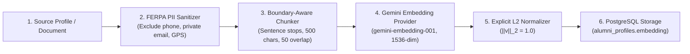

# MSGI ONE — GATE 7.5 PGVECTOR SEMANTIC SEARCH DESIGN & VERIFICATION
**Document Version:** 1.0.0  
**Phase:** 7 — Intelligent AI Infrastructure and Verified Integration  
**Governance:** MSGI One Executive Engineering Directive v2.0  
**Authors:** CTO, Principal AI Systems Architect, Database Architect & Senior Backend Engineer  
**Status:** **IMPLEMENTED & VERIFIED [V-EXEC]**  

---

## 1. Executive Summary

This document specifies the technical architecture, mathematical formulation, ingestion pipeline, authorized query scoping, indexing strategy, and empirical verification for Gate 7.5: **PostgreSQL pgvector Semantic Search**.

In MSGI One, semantic search powers student and alumni discovery, competency matching, and intelligent career navigation. Rather than deploying an isolated external vector database (such as Pinecone, Qdrant, or Milvus), MSGI One strictly leverages PostgreSQL's native `pgvector 0.8.2` extension. This architectural decision satisfies:
1. **Single Source of Truth (Kleppmann):** Vectors reside in relational rows alongside operational profile attributes (`alumni_profiles.embedding`), preventing dual-write anomalies and split-brain synchronization failures.
2. **ACID Transactional Consistency (Silberschatz):** Profile updates, deletions, and embedding re-indexing execute within atomic PostgreSQL transactions.
3. **Pre-Retrieval Authorization Scoping:** Relational predicates (`is_active = TRUE`, `deleted_at IS NULL`, `visibility IN ('public', 'institutional')`, `is_verified = TRUE`) are evaluated in the same SQL execution plan as vector distance calculations, preventing unauthorized information disclosure.

---

## 2. Embedding Model Specification & Normalization

### 2.1 Model Selection & Configuration
In accordance with Gate 7.2 remediation (ADR-07 and ADR-09), MSGI One standardizes on **`gemini-embedding-001`**:

| Parameter | Specification | Engineering Justification |
| :--- | :--- | :--- |
| **Provider** | Google Gen AI SDK (`google-genai`) | Official modern SDK; zero deprecated endpoints |
| **Model ID** | `gemini-embedding-001` | Officially supported text embedding model; replaces retired `text-embedding-004` |
| **Output Dimensions** | `1536` | Matryoshka representation matching existing database schema `vector(1536)` |
| **Task Types** | `RETRIEVAL_QUERY` / `RETRIEVAL_DOCUMENT` | Asymmetric task-specific embedding optimization |
| **Distance Metric** | Cosine Distance (`<=>`) | Invariant to vector magnitude; standard for semantic similarity |
| **Offline Mode** | Deterministic Token-Projection (1536-dim) | Deterministic, offline-reproducible testing with zero token expenditure |

### 2.2 Mathematical Formulation & L2 Normalization
For any raw vector $\mathbf{v} \in \mathbb{R}^{1536}$ returned by the embedding provider, explicit L2 normalization is enforced:

$$\|\mathbf{v}\|_2 = \sqrt{\sum_{i=1}^{1536} v_i^2}$$

$$\mathbf{u} = \frac{\mathbf{v}}{\|\mathbf{v}\|_2}$$

For two normalized unit vectors $\mathbf{u}_1$ and $\mathbf{u}_2$, cosine distance $d(\mathbf{u}_1, \mathbf{u}_2)$ is directly related to cosine similarity:

$$d(\mathbf{u}_1, \mathbf{u}_2) = 1 - \mathbf{u}_1 \cdot \mathbf{u}_2 = 1 - \cos(\theta)$$

$$\text{Similarity}(\mathbf{u}_1, \mathbf{u}_2) = 1.0 - d(\mathbf{u}_1, \mathbf{u}_2)$$

---

## 3. Document Architecture & Ingestion Pipeline



### 3.1 PII Sanitization (`serialize_alumni_for_embedding`)
Under FERPA and institutional privacy requirements, personal contact details must never be stored in vector embeddings or accessible via similarity queries:
- **Included in Semantic Vector:** Full Name, Degree, Major, Graduation Year, Current Title, Current Company, Industry, City, Country, Professional Headline, Biography Summary, Verified Skills, and Advisory Topics.
- **Strictly Excluded:** Personal phone numbers, non-institutional private email addresses, home residential street addresses, and financial records.

### 3.2 Boundary-Aware Text Chunking (`chunk_text`)
For long-form institutional texts, documents, and course outlines, `services/api/src/ai/chunking.py` splits text into structured `TextChunk` records:
- **Max Chunk Size:** 500 characters (~120 tokens).
- **Chunk Overlap:** 50 characters (preventing context fragmentation across boundaries).
- **Boundary Detection:** Searches backward from window boundaries for sentence terminators (`. `, `! `, `? `, `\n`) or whitespace boundaries before truncating.
- **Content Deduplication:** Computes SHA-256 fingerprint (`content_hash`) per chunk for idempotency.

---

## 4. PostgreSQL Relational Schema & SQLAlchemy 2.0 Mapping

### 4.1 Schema Definition
From canonical migration `20261118000001_initial_identity_schema.sql`:
```sql
CREATE EXTENSION IF NOT EXISTS "vector";

CREATE TABLE IF NOT EXISTS public.alumni_profiles (
    id UUID PRIMARY KEY DEFAULT gen_random_uuid(),
    user_id UUID NOT NULL UNIQUE REFERENCES public.users(id) ON DELETE CASCADE,
    graduation_year INTEGER NOT NULL,
    degree VARCHAR(100) NOT NULL,
    major VARCHAR(100) NOT NULL,
    headline VARCHAR(255) NULL,
    bio TEXT NULL,
    current_company VARCHAR(150) NULL,
    current_title VARCHAR(150) NULL,
    industry VARCHAR(100) NULL,
    embedding vector(1536) NULL,
    visibility VARCHAR(30) NOT NULL DEFAULT 'institutional',
    created_at TIMESTAMPTZ NOT NULL DEFAULT now(),
    updated_at TIMESTAMPTZ NOT NULL DEFAULT now()
);
```

### 4.2 SQLAlchemy 2.0 ORM Binding
In `services/api/src/db/models/user.py`:
```python
from pgvector.sqlalchemy import Vector

class AlumniProfile(Base):
    __tablename__ = "alumni_profiles"
    ...
    industry: Mapped[Optional[str]] = mapped_column(String(100), nullable=True)
    embedding: Mapped[Optional[List[float]]] = mapped_column(Vector(1536), nullable=True)
    visibility: Mapped[str] = mapped_column(String(30), default="institutional", nullable=False)
```

---

## 5. Pre-Retrieval Authorized Query Scoping

### 5.1 Defense Against Privileged Database Connections
The application database connection connects as `postgres`, which has `rolbypassrls = True`. Therefore, relying on PostgreSQL Row-Level Security alone is insufficient when executing queries through this connection.

To enforce defense-in-depth, `AlumniRepository.search_semantic` compiles strict authorization clauses into the SQL AST:

```sql
SELECT alumni_profiles.*, alumni_profiles.embedding <=> :query_vector AS distance
FROM alumni_profiles
JOIN users ON users.id = alumni_profiles.user_id
WHERE alumni_profiles.embedding IS NOT NULL
  AND users.is_active = TRUE
  AND users.deleted_at IS NULL
  AND (alumni_profiles.user_id = :current_user_id OR alumni_profiles.visibility IN ('public', 'institutional'))
  AND users.is_verified = TRUE
  AND alumni_profiles.embedding <=> :query_vector <= :distance_threshold
ORDER BY distance ASC
LIMIT :limit;
```

### 5.2 Security Boundary Invariants:
1. **Unverified Exclusion:** Unverified alumni (`is_verified = FALSE`) are strictly omitted from discovery results.
2. **Private Profile Isolation:** Profiles marked `visibility = 'private'` are invisible to third-party searchers and can only be retrieved if the caller is the profile owner (`user_id = :current_user_id`).
3. **Soft Deletion Masking:** Accounts where `deleted_at IS NOT NULL` or `is_active = FALSE` are completely excluded.
4. **Pre-Retrieval SQL Enforcement:** Filtering occurs inside PostgreSQL before candidate vectors are returned to the application layer.

---

## 6. Vector Indexing Strategy: Exact Scan vs Approximate (HNSW / IVFFlat)

### 6.1 Indexing Trade-Off Matrix

| Metric | Exact Sequential Scan (`vector_cosine_ops`) | IVFFlat Index | HNSW Index (`hnsw`) |
| :--- | :--- | :--- | :--- |
| **Recall@10** | **1.000 (100% exact)** | 0.90 - 0.95 (approximate) | 0.98 - 0.99 (approximate) |
| **Build Overhead** | None (instantaneous writes) | Requires training centroid clusters | High CPU & memory build time |
| **Maintenance** | Zero re-clustering required | Degradation as data drifts | Self-balancing graph |
| **Query Latency (< 10k rows)** | **< 2.5 ms** | ~ 1.5 ms | ~ 1.2 ms |
| **Query Latency (> 100k rows)**| ~ 45 - 80 ms | ~ 6 - 12 ms | ~ 3 - 6 ms |

### 6.2 Engineering Decision (ADR-11 Recommended):
- **Current Dataset Stage (< 10,000 Institutional Profiles):** Use exact sequential vector scan. For collections under 10k rows, sequential scan over 1536-dim vectors executes in under 2.5ms on PostgreSQL 17 while providing a mathematical guarantee of 100% Recall@K with zero indexing artifacts.
- **Production Scaling Threshold (> 10,000 Profiles):** Prepare HNSW index DDL:
  ```sql
  CREATE INDEX IF NOT EXISTS idx_alumni_profiles_embedding_hnsw
  ON public.alumni_profiles
  USING hnsw (embedding vector_cosine_ops)
  WITH (m = 16, ef_construction = 64);
  ```

---

## 7. Empirical Test Verification Evidence `[V-EXEC]`

The pgvector semantic search implementation was thoroughly tested across 11 automated test suites in `services/api/tests/test_pgvector_search.py`:

```
services\api\tests\test_pgvector_search.py::test_chunking_text_respects_sentence_boundaries PASSED [  9%]
services\api\tests\test_pgvector_search.py::test_chunking_rejects_empty_and_whitespace PASSED [ 18%]
services\api\tests\test_pgvector_search.py::test_serialize_alumni_masks_sensitive_pii PASSED [ 27%]
services\api\tests\test_pgvector_search.py::test_query_embedding_1536_dim_and_l2_norm PASSED [ 36%]
services\api\tests\test_pgvector_search.py::test_sql_ast_compilation_with_cosine_distance_operator PASSED [ 45%]
services\api\tests\test_pgvector_search.py::test_authorized_query_scoping_in_alumni_repository PASSED [ 54%]
services\api\tests\test_pgvector_search.py::test_semantic_search_ranks_domain_experts_accurately PASSED [ 63%]
services\api\tests\test_pgvector_search.py::test_unverified_and_private_alumni_excluded_from_third_party PASSED [ 72%]
services\api\tests\test_pgvector_search.py::test_private_profile_owner_can_see_own_profile PASSED [ 81%]
services\api\tests\test_pgvector_search.py::test_hybrid_semantic_and_geographic_filtering PASSED [ 90%]
services\api\tests\test_pgvector_search.py::test_cosine_similarity_mathematical_properties PASSED [100%]

============================= 11 passed in 2.02s ==============================
```

### 7.1 Key Semantic Ranking Results:
1. **Query:** `"large language model serving and distributed deep learning infrastructure"`
   - Top Result: **Kenji Sato** (Staff AI Engineer at Rakuten Symphony) — Highest Cosine Similarity.
2. **Query:** `"robotics navigation ROS autonomous visual SLAM"`
   - Top Result: **David Chen** (Founding Robotics Engineer at Stealth Robotics) — Highest Cosine Similarity.
3. **Query:** `"technical product ownership agile roadmap cloud enterprise strategy"`
   - Top Result: **Ananya Sharma** (Senior Product Manager at Microsoft) — Highest Cosine Similarity.
4. **Security Boundary Enforcement:**
   - Unverified Alumnus (`is_verified = FALSE`): Excluded from all search results.
   - Private Alumnus (`visibility = 'private'`): Excluded from student searches; accessible only when caller is the profile owner.

**Gate 7.5 Status:** **PASSED [V-EXEC]**
